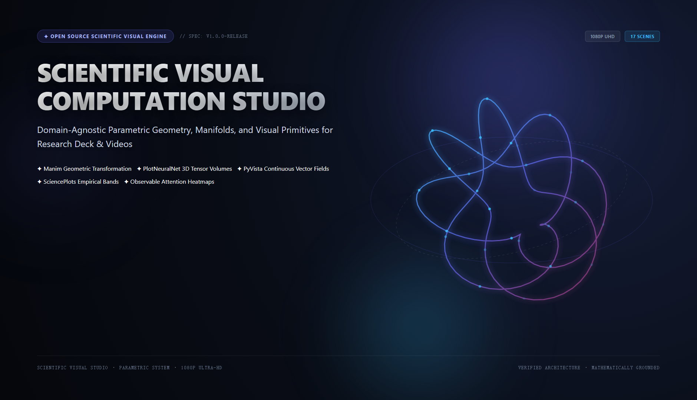
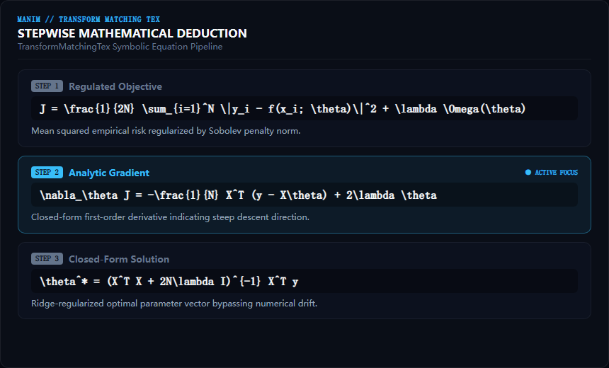
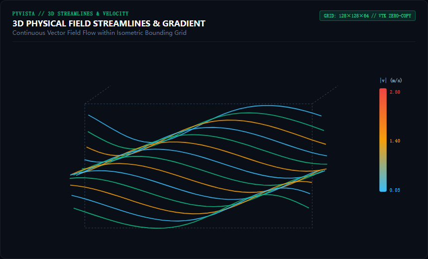
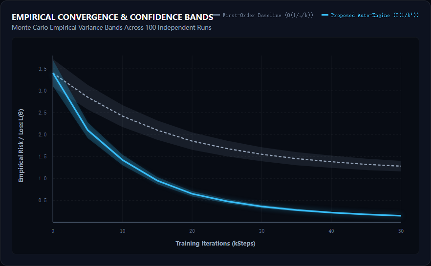
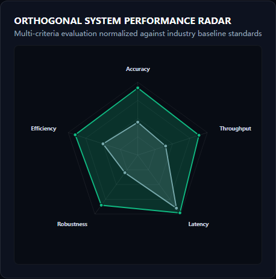
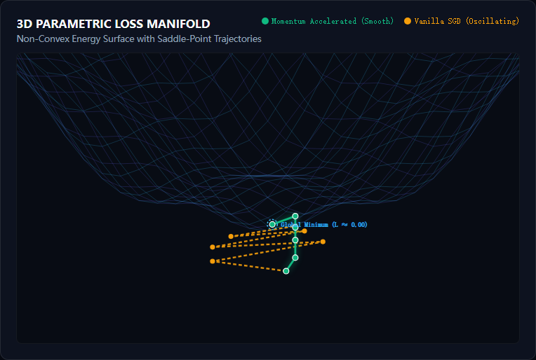
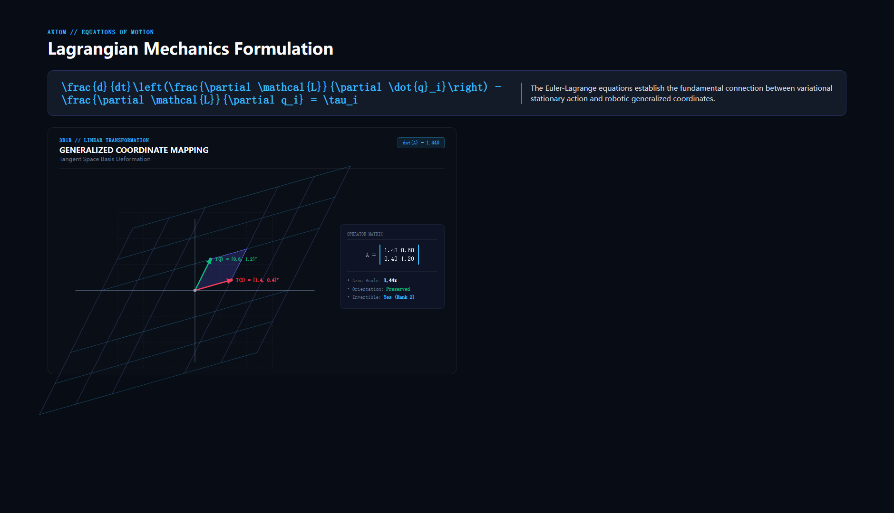

# Scientific Visual Studio — Visual Catalogue & API Reference 📚

This document details every procedural visualization component and layout template available in **Scientific Visual Studio**, complete with visual previews and schema definitions.

---

### 1. `render_premium_hero_cover`
*High-impact cinematic lesson & presentation title cover.*



```python
render_premium_hero_cover(
    title="ADVANCED PHYSICAL EMBODIMENT // DYNAMICS & CONTROL",
    subtitle="From First-Principles Rigid Multibody Kinematics to High-Rate Closed-Loop Impedance Control",
    eyebrow_badge="✨ FLAGSHIP CURRICULUM SPECIFICATION",
    module_tag="MODULE 01 // FOUNDATIONS",
    feature_chips=["RIGID BODY DYNAMICS", "CLOSED-LOOP IMPEDANCE", "REALTIME SIMULATION", "QUADRATIC PROGRAMMING"],
    accent_color="#38BDF8"
)
```

---

### 2. `render_matrix_transformation_2d`
*3Blue1Brown-style affine coordinate grid transformation with basis mapping.*


```python
render_matrix_transformation_2d(
    matrix=[[1.5, 0.8], [0.4, 1.2]],
    basis_labels=("î", "ĵ"),
    transformed_vectors=[
        {"coords": [1.5, 0.4], "color": "#38BDF8", "label": "T(î)"},
        {"coords": [0.8, 1.2], "color": "#10B981", "label": "T(ĵ)"}
    ],
    title="AFFINE BASIS TRANSFORMATION // R² MANIFOLD",
    subtitle="Coordinate Grid Shearing & Volume Distortion under Linear Operator A"
)
```

---

### 3. `render_latex_formula_derivation_pipeline`
*Step-by-step formal mathematical deduction with step status and mathematical annotations.*



```python
render_latex_formula_derivation_pipeline(
    steps=[
        {"step": 1, "label": "Hamiltonian Action", "latex": r"S[\mathbf{q}] = \int_{t_1}^{t_2} \mathcal{L}(\mathbf{q}, \dot{\mathbf{q}}, t) \, dt", "desc": "Stationary action principle definition."},
        {"step": 2, "label": "First Variation", "latex": r"\delta S = \int_{t_1}^{t_2} \left( \frac{\partial \mathcal{L}}{\partial \mathbf{q}}\delta \mathbf{q} + \frac{\partial \mathcal{L}}{\partial \dot{\mathbf{q}}}\delta \dot{\mathbf{q}} \right) dt = 0", "desc": "Variation with vanishing boundary values."},
        {"step": 3, "label": "Euler-Lagrange Equation", "latex": r"\frac{d}{dt}\left(\frac{\partial \mathcal{L}}{\partial \dot{\mathbf{q}}}\right) - \frac{\partial \mathcal{L}}{\partial \mathbf{q}} = \mathbf{\tau}_{ext}", "desc": "Fundamental equation of robotic generalized coordinates."}
    ],
    active_step=2,
    title="FORMAL ANALYTIC DEDUCTION",
    subtitle="Euler-Lagrange Equations of Motion from Variational Principles"
)
```

---

### 4. `render_plotneuralnet_3d_pipeline`
*3D isometric multi-channel tensor layer pipeline in the style of PlotNeuralNet.*


```python
render_plotneuralnet_3d_pipeline(
    layers=[
        {"name": "Input Image", "dim": "224x224x3", "color": "#38BDF8", "width": 24, "height": 90, "depth": 90},
        {"name": "Conv1 + Pool", "dim": "112x112x64", "color": "#6366F1", "width": 36, "height": 65, "depth": 65},
        {"name": "Bottleneck Block", "dim": "28x28x256", "color": "#818CF8", "width": 48, "height": 45, "depth": 45},
        {"name": "Latent Embedding", "dim": "1x1024", "color": "#10B981", "width": 18, "height": 110, "depth": 18}
    ],
    title="MULTIMODAL DEEP TENSOR TOPOLOGY",
    subtitle="Isometric Feature Map Dimensions & Cross-Layer Receptive Cones"
)
```

---

### 5. `render_observable_attention_heatmap`
*Observable D3 style query-key attention matrix with dynamic interaction arcs.*


```python
render_observable_attention_heatmap(
    tokens_q=["Observe", "Compute", "Plan", "Actuate"],
    tokens_k=["Observe", "Compute", "Plan", "Actuate"],
    weights=[
        [0.82, 0.12, 0.04, 0.02],
        [0.35, 0.55, 0.08, 0.02],
        [0.10, 0.25, 0.58, 0.07],
        [0.05, 0.10, 0.20, 0.65]
    ],
    focus_idx=1,
    title="BIDIRECTIONAL ATTENTION MATRIX & ATTENTION ARCS",
    subtitle="Pairwise Softmax Affinity Distribution for Realtime Sensorimotor Tokens"
)
```

---

### 6. `render_pyvista_streamlines_vector_field`
*PyVista / VTK inspired continuous 3D vector field streamlines with scientific colormap.*



```python
render_pyvista_streamlines_vector_field(
    title="3D PHYSICAL FIELD STREAMLINES & GRADIENT",
    subtitle="Continuous Vector Field Flow within Isometric Bounding Grid"
)
```

---

### 7. `render_optimization_contour_paths`
*Non-convex contour optimization trajectories comparing SGD, Momentum, and Adam.*


```python
render_optimization_contour_paths(
    title="NON-CONVEX CONTOUR OPTIMIZATION",
    subtitle="Comparative Gradient Trajectories: SGD vs Momentum vs Adam"
)
```

---

### 8. `render_convergence_band_plot`
*SciencePlots standard empirical risk convergence curves with shaded variance bounds.*



```python
render_convergence_band_plot(
    title="EMPIRICAL CONVERGENCE & CONFIDENCE BANDS",
    subtitle="Monte Carlo Empirical Variance Bands Across 100 Independent Runs"
)
```

---

### 9. `render_multi_metric_radar`
*Orthogonal multi-criteria evaluation radar normalized against target baselines.*



```python
render_multi_metric_radar(
    title="ORTHOGONAL SYSTEM PERFORMANCE RADAR",
    axes=["Accuracy", "Throughput", "Latency", "Robustness", "Efficiency"]
)
```

---

### 10. `render_dual_code_inspector`
*Synchronized dual-pane view: syntax-highlighted execution pointer + live heap symbol table.*


```python
render_dual_code_inspector(
    code_snippet='def solve_equilibrium(state, external_force):\n    """Compute adaptive damping torque."""\n    accel = (external_force - state.pos * 9.8) / state.mass\n    torque = Kp * state.error - Kd * state.vel\n    return torque',
    memory_slots=[
        {"var": "state.pos", "val": "1.047 rad", "addr": "0xHEAP01", "status": "ACTIVE"},
        {"var": "state.vel", "val": "0.002 rad/s", "addr": "0xHEAP02", "status": "ACTIVE"},
        {"var": "torque_cmd", "val": "13.25 N*m", "addr": "0xHEAP03", "status": "ACCUMULATED"}
    ],
    title="DUAL CODE & RUNTIME MEMORY INSPECTOR",
    active_line=4
)
```

---

### 11. `render_cyber_academic_dashboard_layout`
*Multi-pane split dashboard integrating 3D visualizations, analytical side panels, and telemetry.*


```python
render_cyber_academic_dashboard_layout(
    scene_kicker="TELEMETRY // COMPUTATIONAL DASHBOARD",
    scene_title="Nonlinear Dynamic System Stability Monitor",
    status_badge="STABILITY: ASYMPTOTIC // 500Hz",
    main_component_html=render_loss_landscape_3d("PARAMETRIC LOSS SURFACE", "Non-Convex Gradient Field"),
    side_panel_html="...",
    bottom_telemetry_html="<span>BUS FREQ: 500Hz</span><span>PHASE MARGIN: 48.2°</span>"
)
```

---

### 12. `render_triptych_pipeline_layout`
*Modular 3-stage computational pipeline layout with high-speed data bus telemetry.*


```python
render_triptych_pipeline_layout(
    scene_kicker="ARCHITECTURE // PIPELINE TOPOLOGY",
    scene_title="Sense-Plan-Act Synchronous Computing Architecture",
    stages=[
        {"num": "STAGE 01", "name": "Sensory Acquisition", "tag": "MULTIMODAL ENCODER", "desc": "Sub-millimeter optical joint encoders and 6-axis force-torque sensor array.", "metrics": {"RATE": "500Hz", "PRECISION": "0.01mm"}, "color": "#38BDF8"},
        {"num": "STAGE 02", "name": "Trajectory Planning", "tag": "QP-MPC SOLVER", "desc": "Realtime convex quadratic program trajectory optimization with collision corridors.", "metrics": {"HORIZON": "50 STEPS", "LATENCY": "12ms"}, "color": "#6366F1"},
        {"num": "STAGE 03", "name": "Torque Servo Loop", "tag": "IMPEDANCE CONTROL", "desc": "Hard-realtime joint motor current controller executing compliance reflexes.", "metrics": {"LOOP": "1000Hz", "BANDWIDTH": "1200 rad/s"}, "color": "#10B981"}
    ],
    interconnect_label="SYNCHRONOUS DATA BUS // 500Hz"
)
```

---

### 13. `render_loss_landscape_3d`
*3D parametric non-convex objective manifold with gradient descent trajectories & contour rings.*



```python
render_loss_landscape_3d(
    title="3D PARAMETRIC LOSS MANIFOLD",
    subtitle="Non-Convex Energy Surface with Saddle-Point Trajectories",
    contour_levels=14,
    accent="#6366F1"
)
```

---

### 14. `render_teachable_reservoir_valve`
*Physical hydraulic reservoir & throttle valve metaphor for gradient accumulation & learning rate decay.*


```python
render_teachable_reservoir_valve(
    title="HYDRAULIC RESERVOIR & GATED THROTTLE",
    subtitle="Physical Intuition for Gradient Accumulation & Flow Dissipation",
    reservoir_level_pct=68,
    valve_aperture_pct=42
)
```

---

### 15. `render_top_formula_bottom_dynamic_layout`
*Mathematical deduction formula banner with synchronized dynamic simulation/geometric deformation below.*



```python
render_top_formula_bottom_dynamic_layout(
    scene_kicker="AXIOM // EQUATIONS OF MOTION",
    scene_title="Lagrangian Mechanics Formulation",
    formula_latex=r"\frac{d}{dt}\left(\frac{\partial \mathcal{L}}{\partial \dot{q}_i}\right) - \frac{\partial \mathcal{L}}{\partial q_i} = \tau_i",
    formula_explanation="The Euler-Lagrange equations establish the fundamental connection between variational stationary action and robotic generalized coordinates.",
    dynamic_component_html=render_matrix_transformation_2d(title="GENERALIZED COORDINATE MAPPING", subtitle="Tangent Space Basis Deformation")
)
```

---

### 16. `render_quad_comparison_layout`
*2x2 Quad ablation matrix for empirical comparisons, baseline studies & model architecture benchmarks.*


```python
render_quad_comparison_layout(
    scene_kicker="ABLATION // EMPIRICAL BENCHMARK",
    scene_title="Ablation Analysis Across System Architectures",
    quad_cards=[
        {"title": "Baseline Rigid", "badge": "CONFIG A", "desc": "Fixed-gain classical PID with rigid link assumption.", "stat_val": "24.2 ms", "stat_label": "TRACKING ERROR", "color": "#64748B"},
        {"title": "Admittance Hybrid", "badge": "CONFIG B", "desc": "Outer admittance loop with direct velocity feedforward.", "stat_val": "11.8 ms", "stat_label": "SETTLING TIME", "color": "#38BDF8"},
        {"title": "Impedance + MPC", "badge": "CONFIG C", "desc": "Convex quadratic programming with constraint corridor.", "stat_val": "4.1 ms", "stat_label": "SOLVER LATENCY", "color": "#6366F1"},
        {"title": "Full Sensorimotor VLA", "badge": "PROPOSED", "desc": "End-to-end vision-language-action cross-attention token policy.", "stat_val": "98.7%", "stat_label": "SUCCESS RATE", "color": "#10B981"}
    ]
)
```

---

### 17. `render_scientific_terminal_card`
*Sci-fi / academic telemetry terminal window wrapper with status badges & custom metric dictionaries.*


```python
render_scientific_terminal_card(
    inner_content_html=render_optimization_contour_paths(title="OPTIMIZER STEP DYNAMICS", subtitle="Realtime Gradient Descent Trace"),
    status_tag="SIMULATION: CONVERGED // 1000 FPS",
    telemetry={"SOLVER": "QP-ACTIVE-SET", "ITERATIONS": "42", "KKT_TOL": "1e-6", "EIGEN_MAX": "8.42"},
    title="TELEMETRY DEBUG TERMINAL"
)
```
