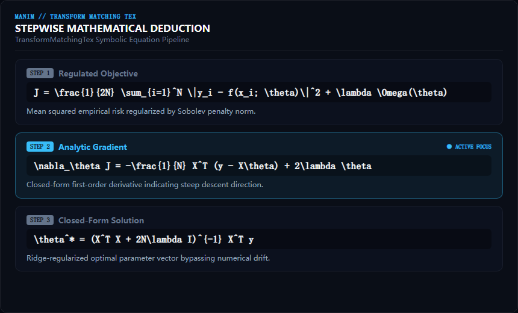

# Scientific Visual Studio 🧪✨

> **Domain-Agnostic Scientific, AI & Mathematical Visual Computation Studio for Agents, Slides, and Video Productions.**

[](https://www.python.org/downloads/)
[](LICENSE)
[](skills/visual-storyboard-designer/SKILL.md)
[](GALLERY.md)

---

## 📑 目录 (Table of Contents)

1. [🌟 核心概览 (Overview)](#-核心概览-overview)
2. [📋 组件完整索引目录 (Component Index)](#-组件完整索引目录-component-index)
   - [2.1 赛博学术风多栏排版布局引擎 (Layout Engines)](#21-赛博学术风多栏排版布局引擎-layout-engines)
   - [2.2 3B1B 线性代数与公式推导 (Mathematical Animation)](#22-3b1b-线性代数与公式推导-mathematical-animation)
   - [2.3 深度学习与张量拓扑结构 (Deep Learning & Tensors)](#23-深度学习与张量拓扑结构-deep-learning--tensors)
   - [2.4 3D 三维科学仿真与流场曲面 (3D Spatial & Vector Fields)](#24-3d-三维科学仿真与流场曲面-3d-spatial--vector-fields)
   - [2.5 科学论文级统计曲线与基准雷达 (SciencePlots & Benchmarking)](#25-科学论文级统计曲线与基准雷达-scienceplots--benchmarking)
   - [2.6 直觉模型与代码执行器 (Teachable Figures & Runtime Code)](#26-直觉模型与代码执行器-teachable-figures--runtime-code)
3. [🎨 视觉组件图库 (Visual Gallery Grid)](#-视觉组件图库-visual-gallery-grid)
4. [📚 引用的开源库与设计说明 (Upstream References & Attribution)](#-引用的开源库与设计说明-upstream-references--attribution)
5. [⚡ 快速上手 (Quick Start)](#-快速上手-quick-start)
6. [🤖 AI Agent 自动化设计集成 (Agent Skill Integration)](#-ai-agent-自动化设计集成-agent-skill-integration)
7. [📁 目录结构 (Repository Structure)](#-目录结构-repository-structure)
8. [🤝 贡献指南 (Contributing)](#-贡献指南-contributing)
9. [📄 开源协议 (License)](#-开源协议-license)

---

## 🌟 核心概览 (Overview)

**Scientific Visual Studio** 是一个专为 AI Agent、学术幻灯片（Reveal.js/Slidev）及程序化视频（Remotion）打造的**纯抽象、无业务绑定的科学可视化组件库与智能体技能包**。

在科研讲解、论文汇报和算法课件中，传统的绘图脚本往往与具体业务场景高度耦合，且依赖庞大的本地 C++/VTK 依赖库。Scientific Visual Studio 借鉴了全球顶尖的开源科研可视化项目，将其核心视觉语言提炼为**轻量、高响应、零庞大 C++ 依赖的纯程序化 HTML/SVG 渲染引擎**：
- **完全解耦业务**：组件接口只接收抽象的张量维度、矩阵系数、流线参数或实验数据点，不硬编码任何具体课程或业务内容。
- **开箱即用的赛博学术画风 (Cyber-Academic)**：深色天体暗蓝底色（`#080C14`）、微光毛玻璃卡片、高对比度科学强调色（Cyan、Indigo、Emerald、Amber）及微等宽遥测标注。
- **全平台嵌入**：可直接输出为独立 HTML、内嵌至 Remotion 视频时间线、嵌入 Web 课件，或通过 Headless 浏览器批量导出为论文级矢量图片。

---

## 📋 组件完整索引目录 (Component Index)

组件库提供 17 个经过严格类型与渲染验证的核心组件与排版引擎，支持按场景检索：

### 2.1 赛博学术风多栏排版布局引擎 (Layout Engines)

| 组件名称 | API 函数签名 | 认知目标 / 适用场景 | 输入参数核心字段 |
| :--- | :--- | :--- | :--- |
| **Hero 电影级封面** | `render_premium_hero_cover(...)` | 课件首页、章节导读、视频片头，营造高级学术氛围 | `title`, `subtitle`, `eyebrow_badge`, `module_tag`, `feature_chips`, `accent_color` |
| **多栏分析仪表盘** | `render_cyber_academic_dashboard_layout(...)` | 复杂系统监控：主视窗三维几何/拓扑 + 右侧符号分析 + 底部总线遥测 | `scene_kicker`, `scene_title`, `status_badge`, `main_component_html`, `side_panel_html`, `bottom_telemetry_html` |
| **三联装流水线布局** | `render_triptych_pipeline_layout(...)` | 三阶段闭环处理流水线（如：感知 ➔ 规划 ➔ 执行） | `scene_kicker`, `scene_title`, `stages` (`list[dict]`), `interconnect_label` |
| **上公式下动态演示** | `render_top_formula_bottom_dynamic_layout(...)` | 上方展示核心定理/公式，下方联动呈现对应的动态几何变换或物理仿真 | `scene_kicker`, `scene_title`, `formula_latex`, `formula_explanation`, `dynamic_component_html` |
| **四象限消融对比矩阵** | `render_quad_comparison_layout(...)` | 2x2 四象限实验对比、基线消融研究（Ablation Study）、参数敏度分析 | `scene_kicker`, `scene_title`, `quad_cards` (`list[dict]` 含指标/状态/说明) |
| **科学遥测终端卡片** | `render_scientific_terminal_card(...)` | 封装任意图表为带边框、实时帧率状态与遥测字典的终端视窗 | `inner_content_html`, `status_tag`, `telemetry` (`dict`), `title`, `width`, `height` |

### 2.2 3B1B 线性代数与公式推导 (Mathematical Animation)

| 组件名称 | API 函数签名 | 认知目标 / 适用场景 | 输入参数核心字段 |
| :--- | :--- | :--- | :--- |
| **二维仿射基底变换** | `render_matrix_transformation_2d(...)` | 线性代数直观：空间坐标网格形变、基向量 $\hat{i},\hat{j}$ 映射、行列式面积缩放与定向 | `matrix` (`2x2 list`), `basis_labels`, `transformed_vectors`, `title`, `subtitle` |
| **解析公式分步推导管线** | `render_latex_formula_derivation_pipeline(...)` | 严密数学推导：从第一性原理到最终方程的多步演绎，高亮当前活跃项与定理注释 | `steps` (`list[dict]` 含 latex/说明/标签), `active_step`, `title`, `subtitle` |

### 2.3 深度学习与张量拓扑结构 (Deep Learning & Tensors)

| 组件名称 | API 函数签名 | 认知目标 / 适用场景 | 输入参数核心字段 |
| :--- | :--- | :--- | :--- |
| **3D 等轴测张量流水线** | `render_plotneuralnet_3d_pipeline(...)` | 多通道特征图、卷积/Transformer 编码块层级堆叠与跨层感受野投影锥 | `layers` (`list[dict]` 含维度/长宽高/颜色), `title`, `subtitle` |
| **自注意力权重交互热力图** | `render_observable_attention_heatmap(...)` | Transformer Query-Key 相似度矩阵分布、Token 交互连线与多头归一化权重 | `tokens_q`, `tokens_k`, `weights` (`2D list`), `focus_idx`, `title`, `subtitle` |

### 2.4 3D 三维科学仿真与流场曲面 (3D Spatial & Vector Fields)

| 组件名称 | API 函数签名 | 认知目标 / 适用场景 | 输入参数核心字段 |
| :--- | :--- | :--- | :--- |
| **三维连续矢量流线场** | `render_pyvista_streamlines_vector_field(...)` | 流体力学、电磁场、空间速度场连续流线积分与科学色彩映射（Colormap） | `title`, `subtitle`, `width`, `height` |
| **3D 非凸损失曲面与梯度** | `render_loss_landscape_3d(...)` | 参数空间非凸曲面流形、鞍点结构、动量法 vs 随机梯度下降小球轨迹 | `title`, `subtitle`, `contour_levels`, `accent` |

### 2.5 科学论文级统计曲线与基准雷达 (SciencePlots & Benchmarking)

| 组件名称 | API 函数签名 | 认知目标 / 适用场景 | 输入参数核心字段 |
| :--- | :--- | :--- | :--- |
| **非凸优化等高线收敛轨迹** | `render_optimization_contour_paths(...)` | 2D 目标等高线图，对比 SGD、Momentum、Adam 向全局最优点收敛的动态路径 | `title`, `subtitle`, `width`, `height` |
| **经验收敛曲线与方差带** | `render_convergence_band_plot(...)` | 投稿级训练收敛折线，包含跨 5 个随机种子的 95% 置信区间透明填充带 | `title`, `subtitle`, `x_label`, `y_label` |
| **正交多维基准雷达图** | `render_multi_metric_radar(...)` | 精度、吞吐率、延迟、鲁棒性、能效比等多维度相对基线雷达拓扑 | `title`, `subtitle`, `axes` (`list[str]`), `datasets` (`list[dict]`) |

### 2.6 直觉模型与代码执行器 (Teachable Figures & Runtime Code)

| 组件名称 | API 函数签名 | 认知目标 / 适用场景 | 输入参数核心字段 |
| :--- | :--- | :--- | :--- |
| **直觉水箱阻尼节流模型** | `render_teachable_reservoir_valve(...)` | 将梯度累积、学习率退火、能量耗散映射为水箱液位与节流阀物理开度 | `title`, `subtitle`, `reservoir_level_pct`, `valve_aperture_pct` |
| **双栏源码与内存拓扑监视器** | `render_dual_code_inspector(...)` | 源码逐行执行游标与运行时堆内存符号表（变量名/地址/状态/值/梯度）实时联动 | `title`, `code_snippet`, `memory_slots` (`list[dict]`), `active_line` |

---

## 🎨 视觉组件图库 (Visual Gallery Grid)

全套 17 个组件效果概览。点击图片可查看高分辨率大图，点击组件名跳转至对应的 API 手册：

| <div align="center"><b>01. Hero Cover 电影级封面</b><br/><a href="assets/gallery/01_hero_cover.html"></a><br/><code>render_premium_hero_cover</code><br/><sub>径向微光、动态网格微粒、版本遥测与技术标签阵列</sub></div> | <div align="center"><b>02. 2D Basis Mapping 二维基底变换</b><br/><a href="assets/gallery/02_matrix_transformation.html"></a><br/><code>render_matrix_transformation_2d</code><br/><sub>3B1B 空间网格形变、基向量映射与行列式面积缩放</sub></div> |
|:---:|:---:|
| <div align="center"><b>03. Formula Derivation 公式推导</b><br/><a href="assets/gallery/03_formula_derivation.html"></a><br/><code>render_latex_formula_derivation_pipeline</code><br/><sub>阶段式推导链路，活跃公式呼吸高亮与推导注释</sub></div> | <div align="center"><b>04. 3D Tensor Topology 张量拓扑</b><br/><a href="assets/gallery/04_plotneuralnet_3d.html"></a><br/><code>render_plotneuralnet_3d_pipeline</code><br/><sub>PlotNeuralNet 等轴测立体张量积木与感受野投影锥</sub></div> |
| <div align="center"><b>05. Attention Heatmap 注意力热力图</b><br/><a href="assets/gallery/05_attention_heatmap.html"></a><br/><code>render_observable_attention_heatmap</code><br/><sub>Query-Key 矩阵色阶、十字聚焦准星与跨词元注意力弧</sub></div> | <div align="center"><b>06. Vector Streamlines 矢量流线场</b><br/><a href="assets/gallery/06_pyvista_streamlines.html"></a><br/><code>render_pyvista_streamlines_vector_field</code><br/><sub>三维流线数值积分、科学色彩标尺与空间包围盒</sub></div> |
| <div align="center"><b>07. Optimization Contours 等高线收敛</b><br/><a href="assets/gallery/07_optimization_contours.html"></a><br/><code>render_optimization_contour_paths</code><br/><sub>非凸势阱等高线，对比 SGD、Momentum、Adam 轨迹</sub></div> | <div align="center"><b>08. Confidence Bands 经验方差带</b><br/><a href="assets/gallery/08_confidence_band.html"></a><br/><code>render_convergence_band_plot</code><br/><sub>SciencePlots 标准训练收敛曲线与 95% 置信方差填充带</sub></div> |
| <div align="center"><b>09. Performance Radar 性能基准雷达</b><br/><a href="assets/gallery/09_radar_chart.html"></a><br/><code>render_multi_metric_radar</code><br/><sub>五维蛛网坐标系与多算法基线重叠评估多边形</sub></div> | <div align="center"><b>10. Dual Code Inspector 源码内存监视</b><br/><a href="assets/gallery/10_dual_code_inspector.html"></a><br/><code>render_dual_code_inspector</code><br/><sub>源码语法高亮执行游标 + 运行时堆变量与梯度表联动</sub></div> |
| <div align="center"><b>11. Cyber Dashboard 赛博多栏仪表盘</b><br/><a href="assets/gallery/11_cyber_dashboard.html"></a><br/><code>render_cyber_academic_dashboard_layout</code><br/><sub>左侧 3D 曲面 + 右侧符号分析 + 底部高频数据总线</sub></div> | <div align="center"><b>12. Triptych Pipeline 三联装架构流水线</b><br/><a href="assets/gallery/12_triptych_pipeline.html"></a><br/><code>render_triptych_pipeline_layout</code><br/><sub>感知-规划-执行闭环拓扑与中继总线吞吐遥测</sub></div> |
| <div align="center"><b>13. 3D Loss Landscape 三维损失流形</b><br/><a href="assets/gallery/13_loss_landscape_3d.html"></a><br/><code>render_loss_landscape_3d</code><br/><sub>非凸参数空间能量曲面、鞍点分岔与下降小球轨迹</sub></div> | <div align="center"><b>14. Reservoir Valve 水箱阻尼节流</b><br/><a href="assets/gallery/14_teachable_reservoir_valve.html"></a><br/><code>render_teachable_reservoir_valve</code><br/><sub>梯度累积与学习率退火物理直觉模型（液位与阀门）</sub></div> |
| <div align="center"><b>15. Top Formula Bottom Dynamic 上下联动</b><br/><a href="assets/gallery/15_top_formula_bottom_dynamic.html"></a><br/><code>render_top_formula_bottom_dynamic_layout</code><br/><sub>顶部拉格朗日数学公理横幅 + 底部广义坐标动态形变</sub></div> | <div align="center"><b>16. Quad Comparison Matrix 四象限消融矩阵</b><br/><a href="assets/gallery/16_quad_comparison_matrix.html"></a><br/><code>render_quad_comparison_layout</code><br/><sub>2x2 多模型基线横向消融评测矩阵与状态关键指标</sub></div> |
| <div align="center"><b>17. Terminal Card 科学遥测终端卡片</b><br/><a href="assets/gallery/17_scientific_terminal_card.html"></a><br/><code>render_scientific_terminal_card</code><br/><sub>实时高频帧率角标、多通道遥测字典与卡片容器包装</sub></div> | <div align="center"><b>🚀 智能体自动化套件</b><br/><br/><b>Agent Skill Ready</b><br/>支持一键集成至 Antigravity / Claude / Cursor<br/><br/><a href="skills/visual-storyboard-designer/SKILL.md">查看 SKILL 详细说明 ➔</a><br/><a href="GALLERY.md">查看 API 详细参数手册 ➔</a></div> |

---

## 📚 引用的开源库与设计说明 (Upstream References & Attribution)

本项目的视觉范式、科学风格与图形算法深受开源学术与动画社区的启发。在此向以下杰出的开源项目致以崇高敬意：

| 开源项目 | 仓库地址 | 核心设计启发与本项目引用/实现说明 |
| :--- | :--- | :--- |
| **Manim (Community & 3B1B)** | [ManimCommunity/manim](https://github.com/ManimCommunity/manim) / [3b1b/manim](https://github.com/3b1b/manim) | **核心启发**：3Blue1Brown 标志性的网格形变、线性变换基底演示与数学之美。<br/>**本项目实现**：将 Manim 重型 Python-Cairo 渲染管线提炼为轻量级 SVG/HTML 矢量计算函数 `render_matrix_transformation_2d`，可免本地安装依赖即时在浏览器和视频帧中运行。 |
| **SciencePlots** | [garrettj403/SciencePlots](https://github.com/garrettj403/SciencePlots) | **核心启发**：Nature、IEEE、Science 顶刊级配色风格、字体比例与无衬线排版规范。<br/>**本项目实现**：将科学论文图表配色与置信区间平滑插值算法移植入 `render_convergence_band_plot`，生成即投级别的矢量图表。 |
| **PlotNeuralNet** | [HarisIqbal88/PlotNeuralNet](https://github.com/HarisIqbal88/PlotNeuralNet) | **核心启发**：深度学习顶会论文中最经典的 3D 等轴测多通道张量层级图。<br/>**本项目实现**：构建了纯程序化的 `render_plotneuralnet_3d_pipeline` 渲染器，通过 CSS 3D 透视变换与 SVG 投影锥自动根据维度列表生成张量立体方块。 |
| **figures4papers** | [ChenLiu-1996/figures4papers](https://github.com/ChenLiu-1996/figures4papers) | **核心启发**：耶鲁 CS 博士开源的高质量学术图表集合（Nature MI / ICML / NeurIPS 投稿实践）。<br/>**本项目实现**：吸收其多指标雷达图与消融对比矩阵的设计哲学，构建了 `render_multi_metric_radar` 与 `render_quad_comparison_layout`。 |
| **Observable Plot & D3.js** | [observablehq/plot](https://github.com/observablehq/plot) / [d3/d3](https://github.com/d3/d3) | **核心启发**：现代 Web 交互式数据可视化、注意力矩阵与层级关系连线。<br/>**本项目实现**：在 `render_observable_attention_heatmap` 中实现了高响应的 Query-Key 双向十字聚焦与动态贝塞尔注意力弧线。 |
| **PyVista & Viser** | [pyvista/pyvista](https://github.com/pyvista/pyvista) / [nerfstudio-project/viser](https://github.com/nerfstudio-project/viser) | **核心启发**：VTK 现代化网格计算与具身智能/机器人 Web 端 3D 空间可视化。<br/>**本项目实现**：将 3D 流线数值积分与伪彩渲染抽象为免装 VTK 的 `render_pyvista_streamlines_vector_field` 与三维损失流形。 |
| **JAnim & Motion Canvas** | [motion-canvas/motion-canvas](https://github.com/motion-canvas/motion-canvas) | **核心启发**：基于程序化 Generator 的现代动画时间轴驱动与响应式幻灯片排版。<br/>**本项目实现**：为所有组件注入了基于 CSS Variable 与语义 Class 的动画驱动机制，与 Remotion 帧渲染 100% 兼容。 |

---

## ⚡ 快速上手 (Quick Start)

### 1. 安装

支持以源码 editable 模式或标准 Python 模块安装：

```bash
git clone https://github.com/TardisBooo/scientific-visual-studio.git
cd scientific-visual-studio
pip install -e .
```

### 2. Python 代码调用示例

```python
from scientific_visual_studio import (
    render_loss_landscape_3d,
    render_cyber_academic_dashboard_layout,
    render_latex_formula_derivation_pipeline
)

# 1. 生成 3D 损失曲面
loss_surface = render_loss_landscape_3d(
    title="PARAMETRIC LOSS SURFACE // ADAM VS SGD",
    subtitle="Non-Convex Energy Landscape with Saddle Points",
    contour_levels=14
)

# 2. 嵌入赛博学术仪表盘中
dashboard_html = render_cyber_academic_dashboard_layout(
    scene_kicker="TELEMETRY // OPTIMIZATION RUNTIME",
    scene_title="Hamiltonian Energy Landscape Evolution",
    status_badge="STATUS: STABLE // 1000Hz",
    main_component_html=loss_surface,
    side_panel_html="""
    <div style="color: #94A3B8; font-size: 13px; line-height: 1.6;">
        <h4 style="color: #38BDF8; margin-top: 0;">Analytic Observation</h4>
        <p>Hessian spectrum indicates positive-definite curvature along principal manifold.</p>
    </div>
    """,
    bottom_telemetry_html="<span>BUS: 500Hz</span><span>PHASE MARGIN: 48.2°</span>"
)

# 写入 HTML 文件直接用浏览器预览或导入视频
with open("preview.html", "w", encoding="utf-8") as f:
    f.write(dashboard_html)
```

---

## 🤖 AI Agent 自动化设计集成 (Agent Skill Integration)

本项目内置符合智能体开放规范的 **Agent Skill**（位于 `skills/visual-storyboard-designer/`），开箱即用于 **Google Antigravity**、**Claude Code**、**Cursor** 等 Agent 系统。

### 运作机制
当用户向 Agent 发出技术汇报、课件设计或视频生成指令时，Agent 会执行认知映射流程：
1. **语义分类**：分析文本认知目标（例如：“需要推导欧拉-拉格朗日方程” ➔ 匹配 `INTENT_AXIOM_MATH`；“需要解释模型三阶段架构” ➔ 匹配 `INTENT_ARCHITECTURE`）。
2. **排版选择**：根据信息复杂度选择单栏、双栏仪表盘或三联装流水线布局。
3. **参数填装**：提取核心公式、指标数据和层级维度，调用组件库生成渲染代码，彻底告别单调平庸的纯文字排版。

---

## 📁 目录结构 (Repository Structure)

```
scientific-visual-studio/
├── scientific_visual_studio/          # 核心 Python 库包
│   ├── __init__.py                    # 导出的 17 个核心渲染函数
│   ├── visual_studio.py               # 抽象组件与多栏排版布局实现
│   └── visual_studio_extensions.py    # 扩展渲染器与数学计算工具
├── skills/                            # Agent 智能体技能标准包
│   └── visual-storyboard-designer/    
│       └── SKILL.md                   # 智能体语义映射与 Prompt 规范
├── assets/
│   └── gallery/                       # 预渲染的组件预览原图与 HTML 示例
├── generate_gallery_assets.py         # 基于 Playwright 的自动化图库截图生成脚本
├── pyproject.toml                     # Python 打包配置
├── setup.py                           # 安装脚本
├── README.md                          # 完整的项目主页、索引与引用说明
├── GALLERY.md                         # 详细的组件 API 参数手册
├── CONTRIBUTING.md                    # 社区贡献指南
└── LICENSE                            # Apache 2.0 开源协议
```

---

## 🤝 贡献指南 (Contributing)

我们非常欢迎社区贡献更多科学领域的抽象可视化组件（例如：量子比特 Bloch 球、图神经网络 GNN 聚合、Voronoi 空间划分等）。

详情请参阅 [CONTRIBUTING.md](CONTRIBUTING.md)。

---

## 📄 开源协议 (License)

本项目采用 [Apache 2.0 许可证](LICENSE) 开源。商业友好、学术友好，欢迎自由使用与二次扩展。
