# Scientific Visual Studio 🧪✨

**English** | [中文说明](README_ZH.md)

> **Domain-Agnostic Scientific, AI & Mathematical Visual Computation Studio for Agents, Slides, and Video Productions.**

[](https://www.python.org/downloads/)
[](LICENSE)
[](skills/visual-storyboard-designer/SKILL.md)
[](.claude-plugin/plugin.json)
[](.cursor/rules/visual-storyboard-designer.mdc)
[](package.json)
[](GALLERY.md)

---

## 🌟 Overview

**Scientific Visual Studio** is a pure, domain-agnostic visual computation and layout generation engine tailored for AI coding agents (Google Antigravity, Claude Code, Cursor, OpenAI Codex, DSH), academic presentation slides (Reveal.js / Slidev), and programmatic video renderers (Remotion).

In scientific reporting and algorithmic lectures, plotting scripts are traditionally coupled with proprietary business logic and burdened by heavy native C++/VTK runtime dependencies. Scientific Visual Studio synthesizes design principles and geometry specifications from over 15 world-leading open-source scientific tools (Manim, SciencePlots, Qiskit, PlotNeuralNet, PyVista, RDKit, scikit-rf, Astropy, etc.) into **lightweight, zero-C++-dependency programmatic HTML/SVG rendering components**:
- **Strictly Domain-Agnostic**: Accepts solely pure numeric arrays, tensor geometries, orbital mass ratios, or impedance parameters.
- **Cyber-Academic Aesthetics**: Deep cosmos background (`#080C14`), glassmorphism cards, vivid glowing accents, and monospace telemetry badges.
- **Agent Ecosystem Ready**: Emits clean standalone SVG/HTML or embeds seamlessly into Remotion composition pipelines and Web slides.

---

## 🎨 Visual Gallery Grid

All 26 interdisciplinary scientific visualization components and cyber-academic layouts at a glance. Click any card to inspect the interactive HTML render, or view the component's API documentation:

| <div align="center"><b>01. Hero Cover</b><br/><a href="assets/gallery/01_hero_cover.html">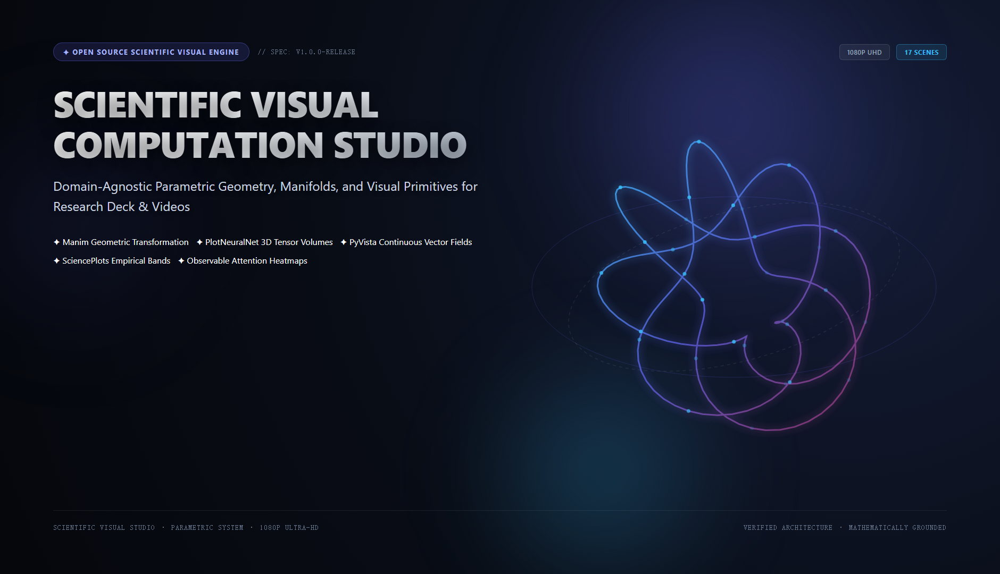</a><br/><code>render_premium_hero_cover</code><br/><sub>Radial glow, dynamic grid particle arrays, version telemetry & tech badges</sub></div> | <div align="center"><b>02. 2D Basis Mapping</b><br/><a href="assets/gallery/02_matrix_transformation.html">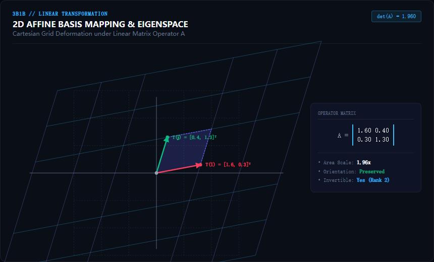</a><br/><code>render_matrix_transformation_2d</code><br/><sub>3B1B spatial grid shearing, basis vector mapping & determinant area</sub></div> |
|:---:|:---:|
| <div align="center"><b>03. Formula Derivation</b><br/><a href="assets/gallery/03_formula_derivation.html"></a><br/><code>render_latex_formula_derivation_pipeline</code><br/><sub>Staged symbolic deduction pipeline, active step glow & rationale badges</sub></div> | <div align="center"><b>04. 3D Tensor Topology</b><br/><a href="assets/gallery/04_plotneuralnet_3d.html">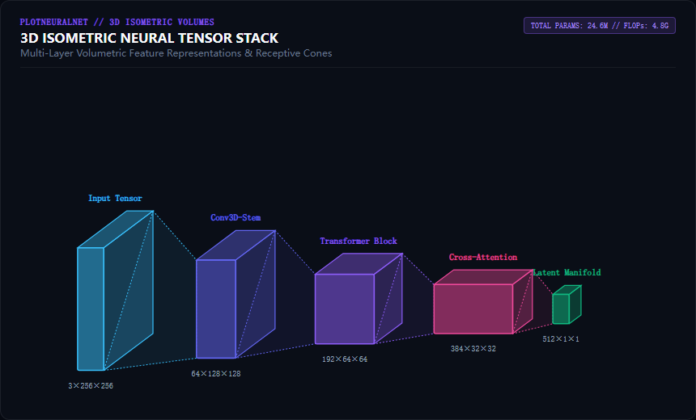</a><br/><code>render_plotneuralnet_3d_pipeline</code><br/><sub>PlotNeuralNet isometric 3D tensor cuboids & cross-layer receptive cones</sub></div> |
| <div align="center"><b>05. Attention Heatmap</b><br/><a href="assets/gallery/05_attention_heatmap.html">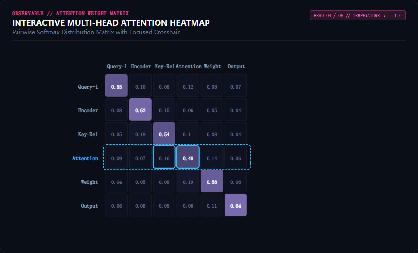</a><br/><code>render_observable_attention_heatmap</code><br/><sub>Query-Key Softmax matrix scales, crosshair focal reticle & attention arcs</sub></div> | <div align="center"><b>06. Vector Streamlines</b><br/><a href="assets/gallery/06_pyvista_streamlines.html">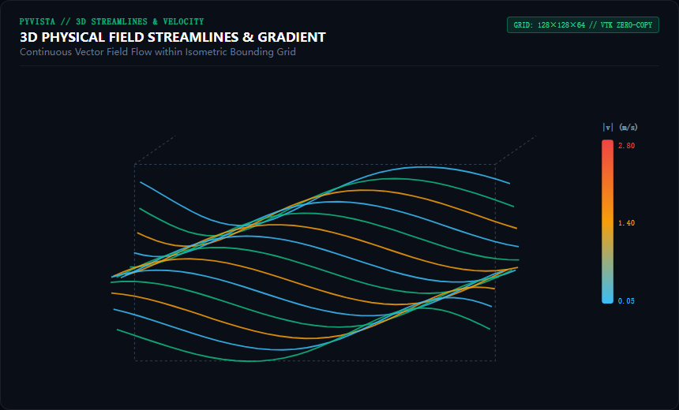</a><br/><code>render_pyvista_streamlines_vector_field</code><br/><sub>3D numerical streamline integration, scientific colormap & bounding box</sub></div> |
| <div align="center"><b>07. Optimization Contours</b><br/><a href="assets/gallery/07_optimization_contours.html">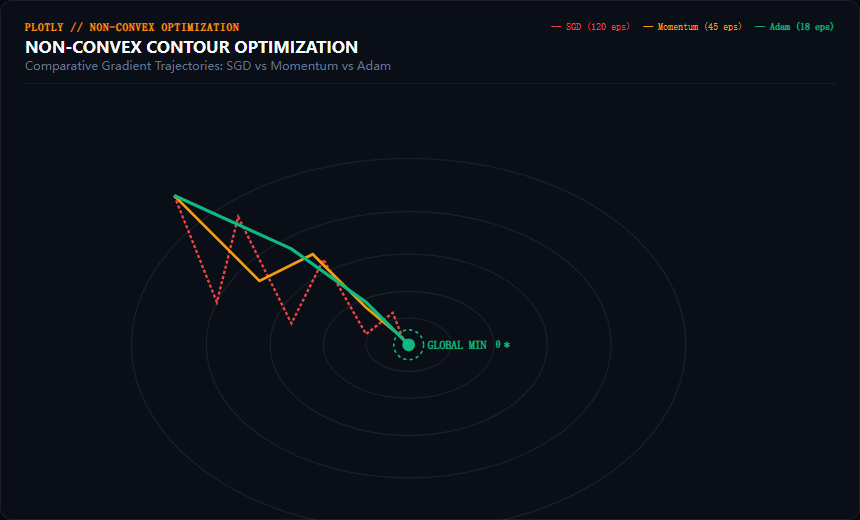</a><br/><code>render_optimization_contour_paths</code><br/><sub>Non-convex potential well contours, SGD vs Momentum vs Adam paths</sub></div> | <div align="center"><b>08. Confidence Bands</b><br/><a href="assets/gallery/08_confidence_band.html">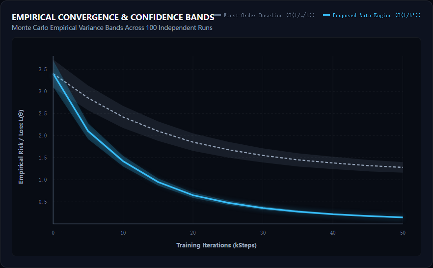</a><br/><code>render_convergence_band_plot</code><br/><sub>SciencePlots IEEE/Nature training curve with 95% variance confidence fill</sub></div> |
| <div align="center"><b>09. Performance Radar</b><br/><a href="assets/gallery/09_radar_chart.html"></a><br/><code>render_multi_metric_radar</code><br/><sub>5-dimensional polar spider chart & multi-model ablation polygon overlays</sub></div> | <div align="center"><b>10. Dual Code Inspector</b><br/><a href="assets/gallery/10_dual_code_inspector.html">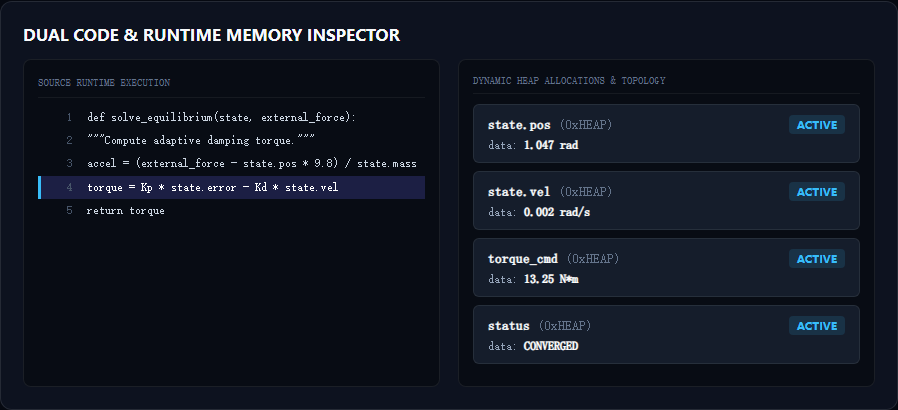</a><br/><code>render_dual_code_inspector</code><br/><sub>Syntax-highlighted execution cursor + live heap variable/tensor inspector</sub></div> |
| <div align="center"><b>11. Cyber Dashboard</b><br/><a href="assets/gallery/11_cyber_dashboard.html">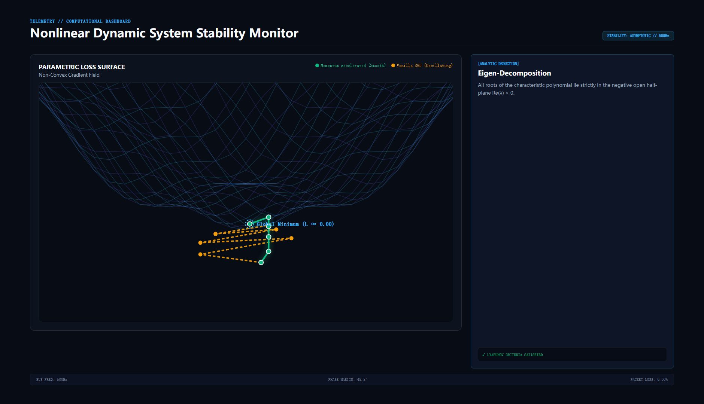</a><br/><code>render_cyber_academic_dashboard_layout</code><br/><sub>Left 3D surface + right symbolic derivation + bottom telemetry data bus</sub></div> | <div align="center"><b>12. Triptych Pipeline</b><br/><a href="assets/gallery/12_triptych_pipeline.html">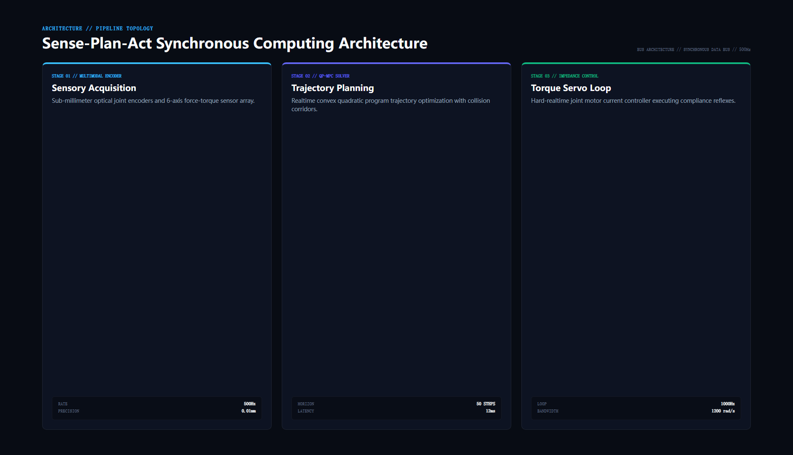</a><br/><code>render_triptych_pipeline_layout</code><br/><sub>Sense-Plan-Act 3-stage closed-loop architecture & throughput telemetry</sub></div> |
| <div align="center"><b>13. 3D Loss Landscape</b><br/><a href="assets/gallery/13_loss_landscape_3d.html">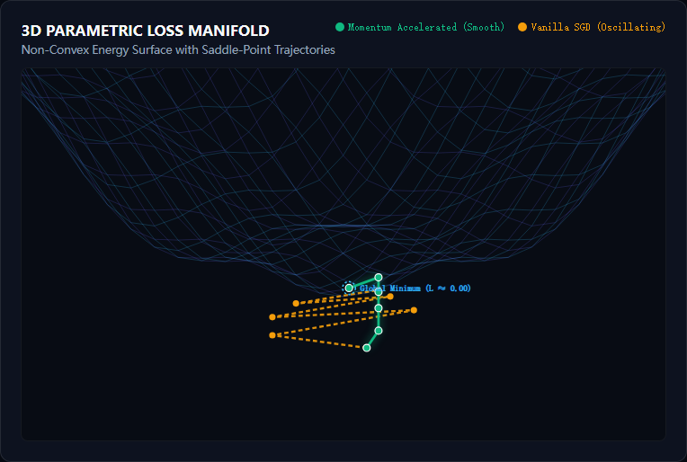</a><br/><code>render_loss_landscape_3d</code><br/><sub>Non-convex parameter manifold, saddle points & gradient ball descent path</sub></div> | <div align="center"><b>14. Reservoir Valve</b><br/><a href="assets/gallery/14_teachable_reservoir_valve.html">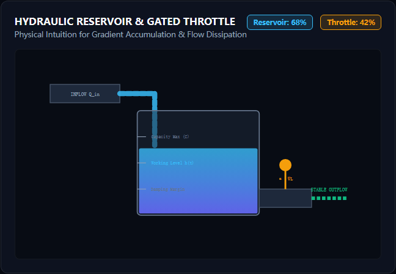</a><br/><code>render_teachable_reservoir_valve</code><br/><sub>Hydraulic metaphor for gradient accumulation & learning rate throttling</sub></div> |
| <div align="center"><b>15. Top Formula Bottom Dynamic</b><br/><a href="assets/gallery/15_top_formula_bottom_dynamic.html">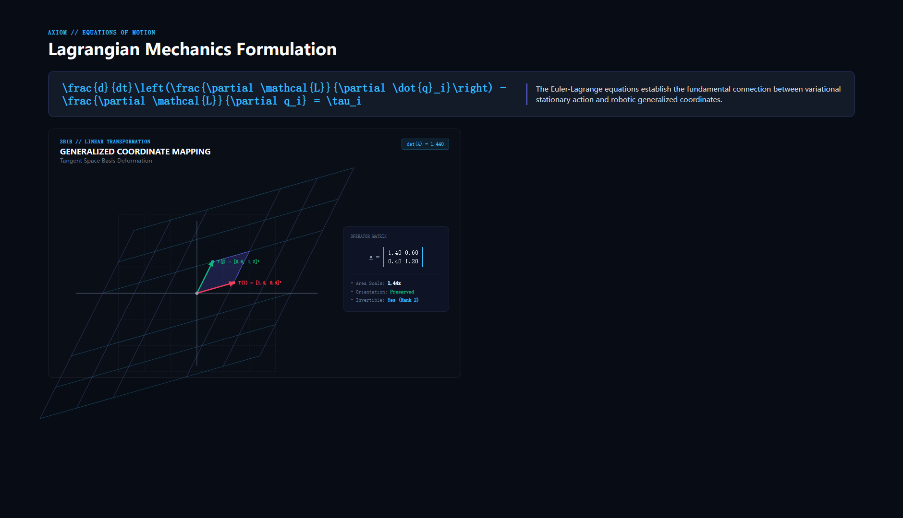</a><br/><code>render_top_formula_bottom_dynamic_layout</code><br/><sub>Top theorem axiom banner + bottom coordinate dynamic deformation</sub></div> | <div align="center"><b>16. Quad Comparison Matrix</b><br/><a href="assets/gallery/16_quad_comparison_matrix.html">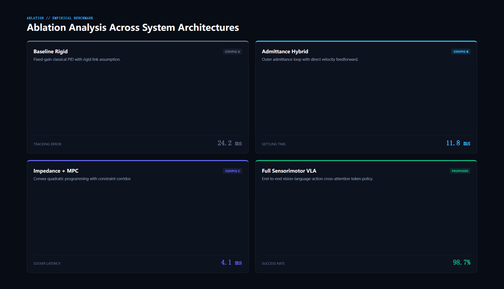</a><br/><code>render_quad_comparison_layout</code><br/><sub>2x2 empirical multi-baseline ablation matrix with key telemetry scores</sub></div> |
| <div align="center"><b>17. Scientific Terminal Card</b><br/><a href="assets/gallery/17_scientific_terminal_card.html">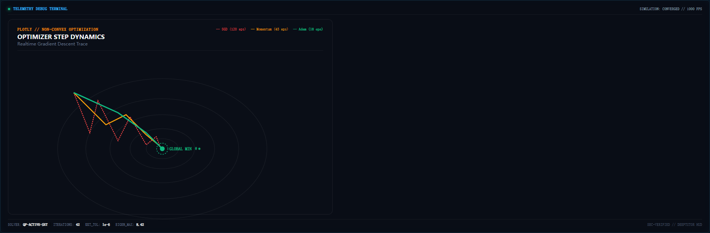</a><br/><code>render_scientific_terminal_card</code><br/><sub>Realtime high-frequency framerate badge, telemetry dictionary & framed card</sub></div> | <div align="center"><b>18. Quantum Bloch & Circuit</b><br/><a href="assets/gallery/18_quantum_bloch_circuit.html">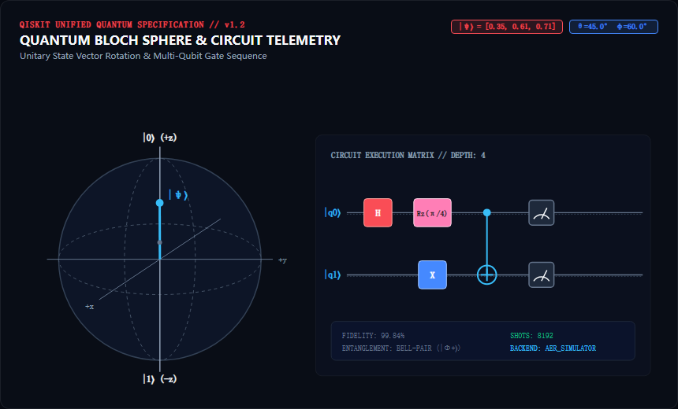</a><br/><code>render_quantum_bloch_circuit</code><br/><sub>Qiskit iqp-dark 3D Bloch sphere state vector + multi-qubit gate circuit</sub></div> |
| <div align="center"><b>19. Bode & Nyquist Analysis</b><br/><a href="assets/gallery/19_bode_nyquist_frequency.html"></a><br/><code>render_bode_nyquist_frequency_plot</code><br/><sub>Log Bode gain/phase margins + complex Nyquist critical point (-1,0) encirclement</sub></div> | <div align="center"><b>20. GNN Message Passing</b><br/><a href="assets/gallery/20_graph_network_topology.html">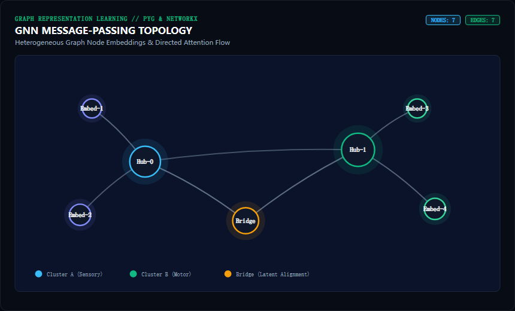</a><br/><code>render_graph_network_topology</code><br/><sub>NetworkX/PyG heterogeneous node halos, cluster hulls & message passing arcs</sub></div> |
| <div align="center"><b>21. Genomic Sequence Ribbon</b><br/><a href="assets/gallery/21_genomic_sequence_ribbon.html"></a><br/><code>render_genomic_sequence_ribbon</code><br/><sub>WebLogo information entropy stacks (0-2 bits) + linear CDS open reading frames</sub></div> | <div align="center"><b>22. DAG Workflow Statechart</b><br/><a href="assets/gallery/22_dag_workflow_statechart.html"></a><br/><code>render_dag_workflow_statechart</code><br/><sub>Airflow/Prefect layered graph, state lifecycles & orthogonal dependency bus</sub></div> |
| <div align="center"><b>23. Chemical Synthesis Scheme</b><br/><a href="assets/gallery/23_molecule_reaction.html">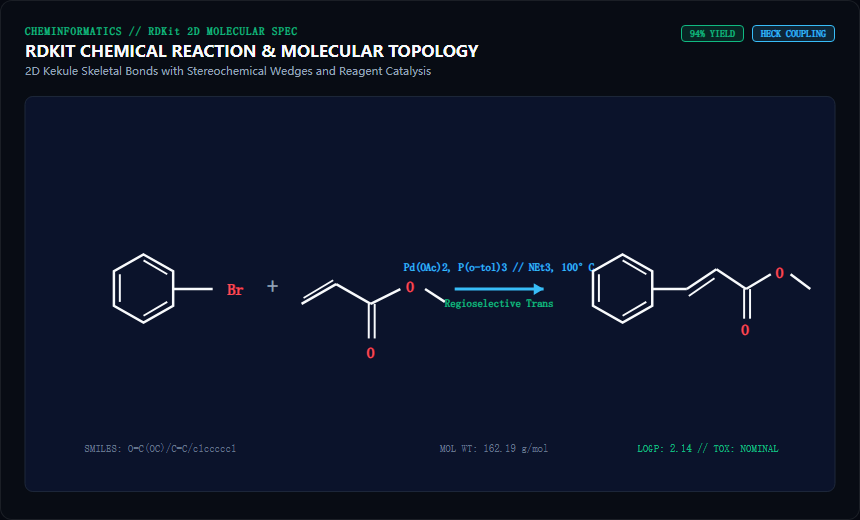</a><br/><code>render_molecule_reaction_scheme</code><br/><sub>RDKit 30°/90° skeletal bonds, wedge stereochemistry, CPK colors & reagents</sub></div> | <div align="center"><b>24. Synodic Lagrange Orbits</b><br/><a href="assets/gallery/24_synodic_lagrange_orbit.html">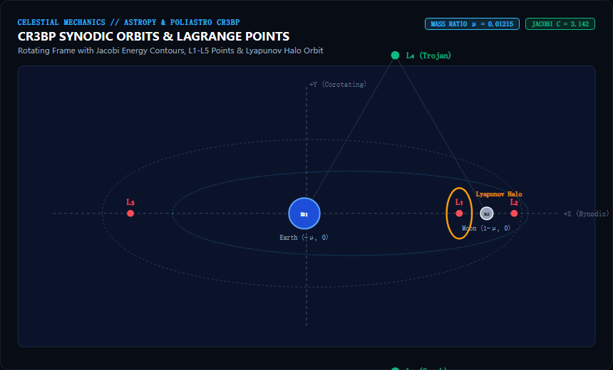</a><br/><code>render_synodic_lagrange_orbit</code><br/><sub>Astropy/Poliastro CR3BP rotating frame, L1-L5 equilibrium points & halo orbit</sub></div> |
| <div align="center"><b>25. Smith Chart & Eye Diagram</b><br/><a href="assets/gallery/25_smith_eye_pair.html">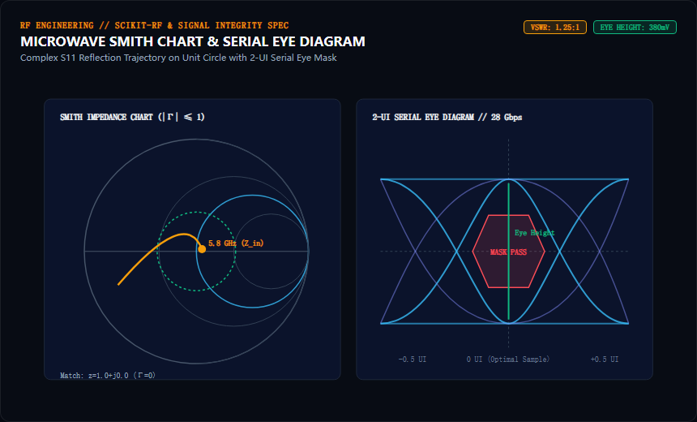</a><br/><code>render_smith_eye_pair</code><br/><sub>scikit-rf resistance/reactance circles + 2-UI serial communication eye mask</sub></div> | <div align="center"><b>26. Feynman Diagram Interaction</b><br/><a href="assets/gallery/26_feynman_diagram.html">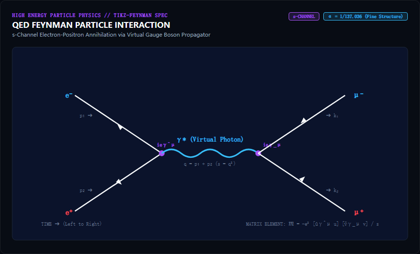</a><br/><code>render_feynman_diagram_interaction</code><br/><sub>TikZ-Feynman QED s-channel fermion lines, virtual photon wave & vertices</sub></div> |

*For complete Python API parameters and code snippets, see [GALLERY.md](GALLERY.md).*

---

## 📋 Complete Component Index

| Category | Component | API Function | Reference Academic Standards |
|:---|:---|:---|:---|
| **Layouts** | Hero Panoramic Cover | `render_premium_hero_cover` | Widescreen Cyber-Academic Header Spec |
| **Layouts** | Cyber Telemetry Dashboard | `render_cyber_academic_dashboard_layout` | Multi-Pane Telemetry Split Dashboard |
| **Layouts** | Triptych Architecture Pipeline | `render_triptych_pipeline_layout` | Sense-Plan-Act 3-Stage Closed Loop |
| **Layouts** | Formula & Dynamic Split | `render_top_formula_bottom_dynamic_layout` | Theorem-Proof Synchronous Split |
| **Layouts** | Quad Ablation Matrix | `render_quad_comparison_layout` | 2x2 Empirical Benchmark Quad Matrix |
| **Layouts** | Scientific Terminal Card | `render_scientific_terminal_card` | Framed Realtime Telemetry Wrapper |
| **Math & Geometry** | 2D Basis Transformation | `render_matrix_transformation_2d` | 3Blue1Brown / Manim Basis Mapping |
| **Math & Geometry** | Step-by-Step Derivation | `render_latex_formula_derivation_pipeline` | TransformMatchingTex Step Pipeline |
| **Quantum Physics** | Quantum State & Circuit | `render_quantum_bloch_circuit` | Qiskit / QuTiP Bloch Sphere & Circuit |
| **Deep Learning** | 3D Isometric Tensor Network | `render_plotneuralnet_3d_pipeline` | PlotNeuralNet / ConvNetDraw 3D Tensors |
| **Deep Learning** | Self-Attention Heatmap | `render_observable_attention_heatmap` | Observable Plot Query-Key Softmax & Arcs |
| **Graph Learning** | GNN Message Passing | `render_graph_network_topology` | PyG / NetworkX Heterogeneous Topology |
| **Control Systems** | Bode / Nyquist Stability | `render_bode_nyquist_frequency_plot` | Python-Control Frequency & Nyquist (-1, 0) |
| **Scientific Fluids** | Vector Streamline Field | `render_pyvista_streamlines_vector_field` | PyVista / VTK Continuous Vector Streamlines |
| **Optimization** | 3D Non-Convex Loss Surface | `render_loss_landscape_3d` | Hao Li Non-Convex Loss Landscape |
| **Optimization** | Optimizer Contour Paths | `render_optimization_contour_paths` | SGD vs Momentum vs Adam Convergence Paths |
| **Statistical Curves** | Empirical Variance Band | `render_convergence_band_plot` | SciencePlots IEEE / Nature 95% Confidence Band |
| **Benchmarking** | Orthogonal Metric Radar | `render_multi_metric_radar` | Normalized Multi-Criteria Orthogonal Profile |
| **Computational Bio** | Genomic Sequence Ribbon | `render_genomic_sequence_ribbon` | Biopython / WebLogo (0-2 bits) & DNA Features |
| **Task Scheduling** | DAG Workflow Statechart | `render_dag_workflow_statechart` | Apache Airflow / Prefect / XState DAG |
| **Cheminformatics** | 2D Molecule Reaction Scheme | `render_molecule_reaction_scheme` | RDKit Kekule 30°/90° Skeletal & Reagents |
| **Celestial Mechanics**| Synodic Lagrange Orbits | `render_synodic_lagrange_orbit` | Astropy & Poliastro CR3BP Synodic L1-L5 Orbit |
| **RF Engineering** | Smith Chart & Eye Diagram | `render_smith_eye_pair` | scikit-rf Smith Chart (r, x) Circles & Eye Mask |
| **Particle Physics** | Feynman Interaction Diagram | `render_feynman_diagram_interaction` | TikZ-Feynman QED s-Channel Fermion / Photon Wave |
| **Pedagogical Metaphor**| Hydraulic Reservoir Valve | `render_teachable_reservoir_valve` | Teachable Figures Mechanical Metaphor |
| **Runtime Diagnostics**| Dual Code & Heap Inspector | `render_dual_code_inspector` | Synchronized Source Pointer & Heap Topology |

---

## 📚 Upstream References & Design Foundations

Following in-depth exploration with `grok-4.7-heavy`, this studio incorporates specifications from leading open-source projects:

| Project | Stars | Domain / Role | Design Implementation in Studio |
| :--- | :--- | :--- | :--- |
| **[RDKit](https://github.com/rdkit/rdkit)** | 3.7k | Cheminformatics Standard | RDKit `MolDraw2D` 30°/90° skeletal layouts, wedge stereo bonds & CPK color palette (`render_molecule_reaction_scheme`). |
| **[scikit-rf](https://github.com/scikit-rf/scikit-rf)** | 1.0k | Microwave & RF Engineering | Exact circle equations for constant resistance ($r$) and reactance ($x$) with 2-UI high-speed eye mask (`render_smith_eye_pair`). |
| **[Astropy](https://github.com/astropy/astropy)** / **[Poliastro](https://github.com/poliastro/poliastro)** | 5.4k / 1.0k | Celestial & Orbital Mechanics | Circular Restricted Three-Body Problem (CR3BP) rotating frame with L1-L5 equilibrium points (`render_synodic_lagrange_orbit`). |
| **[TikZ-Feynman](https://github.com/JP-Ellis/tikz-feynman)** | 200 | Particle Physics Feynman Graphs | Standard fermion arrow flow, virtual photon transverse sinusoidal wave, and vertex coupling (`render_feynman_diagram_interaction`). |
| **[Qiskit](https://github.com/Qiskit/qiskit)** | 8.0k | Quantum Computing | Qiskit `iqp-dark` styling, 3D Bloch sphere state vector projection & multi-qubit register gates (`render_quantum_bloch_circuit`). |
| **[Python-Control](https://github.com/python-control/python-control)** | 1.7k | Control Theory & Stability | Bode gain/phase frequency margins & complex Nyquist encirclement around $(-1, 0)$ (`render_bode_nyquist_frequency_plot`). |
| **[NetworkX](https://github.com/networkx/networkx)** / **[PyG](https://github.com/pyg-team/pytorch_geometric)** | 17.4k / 20k | Graph Neural Networks | Force-directed topologies with radial aura glow and directed message passing arcs (`render_graph_network_topology`). |
| **[Biopython](https://github.com/biopython/biopython)** / **[WebLogo](https://github.com/gecrooks/weblogo)** | 5.3k / 200 | Bioinformatics & Genomics | Classical nucleotide entropy stacks (0–2 bits) paired with linear CDS feature ribbons (`render_genomic_sequence_ribbon`). |
| **[Apache Airflow](https://github.com/apache/airflow)** / **[Prefect](https://github.com/PrefectHQ/prefect)** | 40.5k / 19.5k | Workflow Orchestration | Orthogonal bus routing & state lifecycle color schemes (`render_dag_workflow_statechart`). |
| **[Manim](https://github.com/3b1b/manim)** / **[Manim Community](https://github.com/ManimCommunity/manim)** | 97k / 43k | Math Animation | 2D affine basis transformation geometry & formula transformation pipelines (`render_matrix_transformation_2d`). |
| **[SciencePlots](https://github.com/garrettj403/SciencePlots)** | 9.4k | Academic Publishing Style | Nature/IEEE standard typography, palette curves & 95% variance confidence envelope (`render_convergence_band_plot`). |
| **[PlotNeuralNet](https://github.com/HarisIqbal88/PlotNeuralNet)** | 19k | Isometric Deep Learning Tensors | CSS 3D perspective cube arrays with SVG cross-layer receptive field cones (`render_plotneuralnet_3d_pipeline`). |
| **[PyVista](https://github.com/pyvista/pyvista)** | 3.9k | 3D Mesh & Field Diagnostics | Continuous 3D vector field streamlines with scientific colormap ramps (`render_pyvista_streamlines_vector_field`). |

---

## 🛒 Why is this not showing up in `dsh-market` search yet? & How to install

### Question: Why can't I search for this repository in `https://github.com/dsh-market/dsh-market`?
**Answer**:
1. **Centralized Static Catalog Architecture**: The `dsh-market` client does not crawl GitHub dynamically. Instead, it periodically synchronizes from two static catalogs:
   - The npm registry package `dsh-plugin-catalog`
   - The curated index `awesome-dsh-plugin.com/plugins.json` (hosted in the GitHub repo `bobby-sheng/dshget-data`)
2. **Newly Created Repositories**: Freshly created GitHub repositories that haven't been submitted to the upstream catalog or published to npm will not appear in the search box by default.
3. **Full Compatibility Ready**:
   - This repository is fully compliant with DSH standards, providing a valid [package.json](package.json) declaring `engines.dsh >= 0.1.0` and `dsh-plugin` keywords.
   - **Direct Installation in DSH**: You can install it directly without waiting for indexing:
     ```bash
     dsh plugin add github:TardisBooo/scientific-visual-studio
     ```
   - **Adding to Official Search**: Submit a Pull Request to `bobby-sheng/dshget-data` or `dsh-market/dsh-market` adding `TardisBooo/scientific-visual-studio` to `plugins.json` to have it indexed globally.

---

## 🤖 Cross-Platform Agent Ecosystem

| Platform | Manifest / Configuration | Installation & Usage |
| :--- | :--- | :--- |
| **Google Antigravity & Grok** | [plugin.json](plugin.json) | Load directly via Plugins Manager or clone to plugins dir |
| **Claude Code** | [CLAUDE.md](CLAUDE.md) / [.claude-plugin/plugin.json](.claude-plugin/plugin.json) | Reads `CLAUDE.md` automatically; invoke components via prompt |
| **Cursor & Codex** | [.cursor/rules/visual-storyboard-designer.mdc](.cursor/rules/visual-storyboard-designer.mdc) / [.codex/skill.json](.codex/skill.json) | Triggered via Composer rules and Agent skills |
| **DeepSeek Harness (DSH)** | [package.json](package.json) / [skills/visual-storyboard-designer/SKILL.md](skills/visual-storyboard-designer/SKILL.md) | `dsh plugin add github:TardisBooo/scientific-visual-studio` |
| **Python Package** | [pyproject.toml](pyproject.toml) | `pip install -e .` |

---

## 📄 License

Licensed under the [Apache 2.0 License](LICENSE). Commercial-friendly and academic-friendly. Feel free to use and extend!
