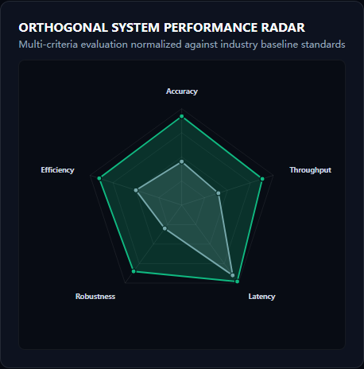
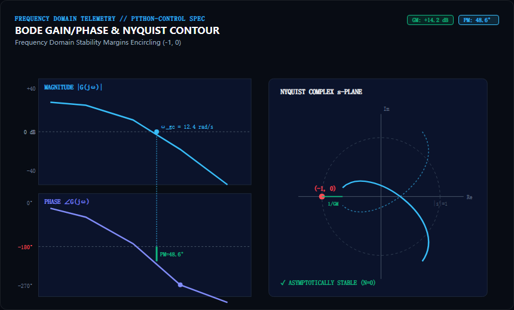
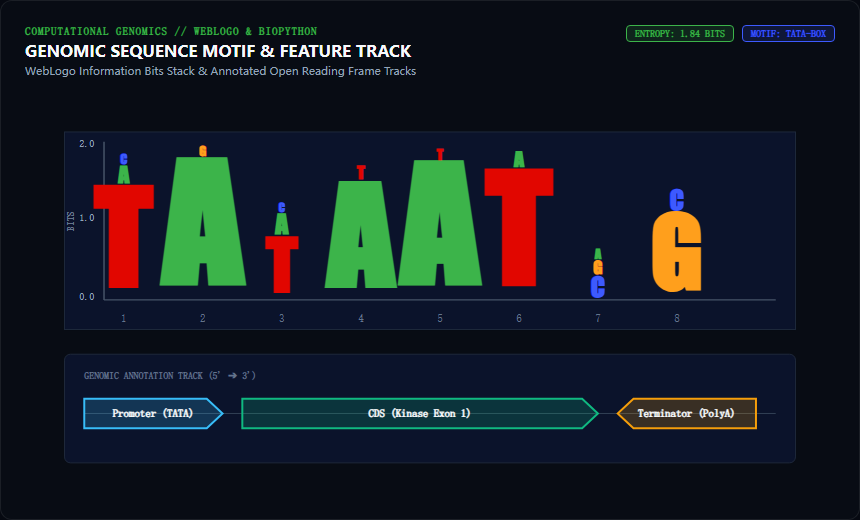
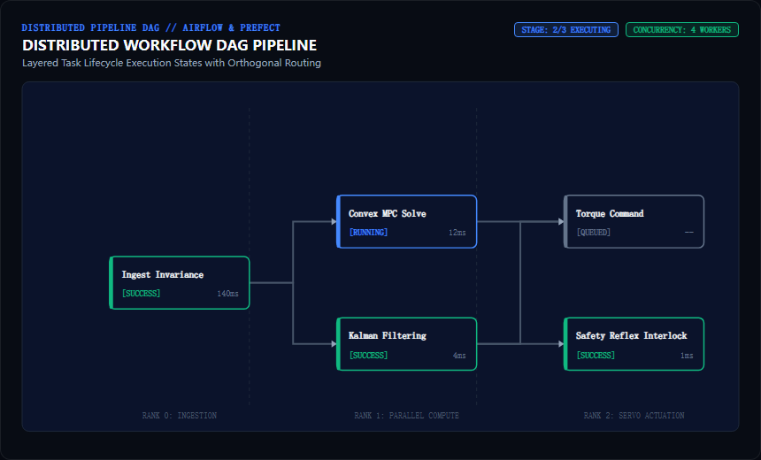

# Scientific Visual Studio 🧪✨

> **Domain-Agnostic Scientific, AI & Mathematical Visual Computation Studio for Agents, Slides, and Video Productions.**

[](https://www.python.org/downloads/)
[](LICENSE)
[](skills/visual-storyboard-designer/SKILL.md)
[](.claude-plugin/plugin.json)
[](.cursor/rules/visual-storyboard-designer.mdc)
[](.codex/skill.json)
[](GALLERY.md)

---

## 🌟 核心概览 (Overview)

**Scientific Visual Studio** 是一个专为 AI Agent（Google Antigravity、Claude Code、OpenAI Codex、Cursor、DSH）、学术幻灯片（Reveal.js/Slidev）及程序化视频（Remotion）打造的**纯抽象、无业务绑定的跨学科科学可视化组件库与智能体技能包**。

在科研汇报、算法课件和视频制作中，传统绘图脚本往往与具体业务场景高度耦合，且依赖庞大的 C++/VTK 本地运行环境。Scientific Visual Studio 汲取了全球 15+ 顶尖开源科研可视化项目（Manim、SciencePlots、Qiskit、PlotNeuralNet、PyVista、NetworkX、Biopython、Control 等）的视觉语言与几何规范，提炼为**轻量、高响应、零庞大 C++ 依赖的纯程序化 HTML/SVG 矢量渲染引擎**。

---

## 🎨 视觉组件图库 (Visual Gallery Grid)

全套 22 个科学可视化组件与赛博学术排版布局一览。点击图片可查看高分辨率大图，点击组件名跳转至对应的 API 手册：

| <div align="center"><b>01. Hero Cover 电影级封面</b><br/><a href="assets/gallery/01_hero_cover.html"></a><br/><code>render_premium_hero_cover</code><br/><sub>径向微光、动态网格微粒、版本遥测与技术标签阵列</sub></div> | <div align="center"><b>02. 2D Basis Mapping 二维基底变换</b><br/><a href="assets/gallery/02_matrix_transformation.html"></a><br/><code>render_matrix_transformation_2d</code><br/><sub>3B1B 空间网格形变、基向量映射与行列式面积缩放</sub></div> |
|:---:|:---:|
| <div align="center"><b>03. Formula Derivation 公式推导</b><br/><a href="assets/gallery/03_formula_derivation.html"></a><br/><code>render_latex_formula_derivation_pipeline</code><br/><sub>阶段式推导链路，活跃公式呼吸高亮与推导注释</sub></div> | <div align="center"><b>04. 3D Tensor Topology 张量拓扑</b><br/><a href="assets/gallery/04_plotneuralnet_3d.html"></a><br/><code>render_plotneuralnet_3d_pipeline</code><br/><sub>PlotNeuralNet 等轴测立体张量积木与感受野投影锥</sub></div> |
| <div align="center"><b>05. Attention Heatmap 注意力热力图</b><br/><a href="assets/gallery/05_attention_heatmap.html"></a><br/><code>render_observable_attention_heatmap</code><br/><sub>Query-Key 矩阵色阶、十字聚焦准星与跨词元注意力弧</sub></div> | <div align="center"><b>06. Vector Streamlines 矢量流线场</b><br/><a href="assets/gallery/06_pyvista_streamlines.html"></a><br/><code>render_pyvista_streamlines_vector_field</code><br/><sub>三维流线数值积分、科学色彩标尺与空间包围盒</sub></div> |
| <div align="center"><b>07. Optimization Contours 等高线收敛</b><br/><a href="assets/gallery/07_optimization_contours.html"></a><br/><code>render_optimization_contour_paths</code><br/><sub>非凸势阱等高线，对比 SGD、Momentum、Adam 轨迹</sub></div> | <div align="center"><b>08. Confidence Bands 经验方差带</b><br/><a href="assets/gallery/08_confidence_band.html"></a><br/><code>render_convergence_band_plot</code><br/><sub>SciencePlots 标准训练收敛曲线与 95% 置信方差填充带</sub></div> |
| <div align="center"><b>09. Performance Radar 性能基准雷达</b><br/><a href="assets/gallery/09_radar_chart.html"></a><br/><code>render_multi_metric_radar</code><br/><sub>五维蛛网坐标系与多算法基线重叠评估多边形</sub></div> | <div align="center"><b>10. Dual Code Inspector 源码内存监视</b><br/><a href="assets/gallery/10_dual_code_inspector.html"></a><br/><code>render_dual_code_inspector</code><br/><sub>源码语法高亮执行游标 + 运行时堆变量与梯度表联动</sub></div> |
| <div align="center"><b>11. Cyber Dashboard 赛博多栏仪表盘</b><br/><a href="assets/gallery/11_cyber_dashboard.html"></a><br/><code>render_cyber_academic_dashboard_layout</code><br/><sub>左侧 3D 曲面 + 右侧符号分析 + 底部高频数据总线</sub></div> | <div align="center"><b>12. Triptych Pipeline 三联装架构流水线</b><br/><a href="assets/gallery/12_triptych_pipeline.html"></a><br/><code>render_triptych_pipeline_layout</code><br/><sub>感知-规划-执行闭环拓扑与中继总线吞吐遥测</sub></div> |
| <div align="center"><b>13. 3D Loss Landscape 三维损失流形</b><br/><a href="assets/gallery/13_loss_landscape_3d.html"></a><br/><code>render_loss_landscape_3d</code><br/><sub>非凸参数空间能量曲面、鞍点分岔与下降小球轨迹</sub></div> | <div align="center"><b>14. Reservoir Valve 水箱阻尼节流</b><br/><a href="assets/gallery/14_teachable_reservoir_valve.html"></a><br/><code>render_teachable_reservoir_valve</code><br/><sub>梯度累积与学习率退火物理直觉模型（液位与阀门）</sub></div> |
| <div align="center"><b>15. Top Formula Bottom Dynamic 上下联动</b><br/><a href="assets/gallery/15_top_formula_bottom_dynamic.html"></a><br/><code>render_top_formula_bottom_dynamic_layout</code><br/><sub>顶部拉格朗日数学公理横幅 + 底部广义坐标动态形变</sub></div> | <div align="center"><b>16. Quad Comparison Matrix 四象限消融矩阵</b><br/><a href="assets/gallery/16_quad_comparison_matrix.html"></a><br/><code>render_quad_comparison_layout</code><br/><sub>2x2 多模型基线横向消融评测矩阵与状态关键指标</sub></div> |
| <div align="center"><b>17. Terminal Card 科学遥测终端卡片</b><br/><a href="assets/gallery/17_scientific_terminal_card.html"></a><br/><code>render_scientific_terminal_card</code><br/><sub>实时高频帧率角标、多通道遥测字典与卡片容器包装</sub></div> | <div align="center"><b>18. Quantum Bloch Circuit 量子态与线路</b><br/><a href="assets/gallery/18_quantum_bloch_circuit.html"></a><br/><code>render_quantum_bloch_circuit</code><br/><sub>Qiskit iqp-dark 3D 布洛赫球面态矢量 + 多比特量子门线路</sub></div> |
| <div align="center"><b>19. Bode / Nyquist 频域响应与稳定性</b><br/><a href="assets/gallery/19_bode_nyquist_frequency.html"></a><br/><code>render_bode_nyquist_frequency_plot</code><br/><sub>对数 Bode 增益/相位裕度 + 复平面 Nyquist 临界点 (-1,0) 绕行</sub></div> | <div align="center"><b>20. GNN Message Passing 图神经网络拓扑</b><br/><a href="assets/gallery/20_graph_network_topology.html"></a><br/><code>render_graph_network_topology</code><br/><sub>NetworkX/PyG 异质图节点光晕、聚类分组与有向消息传递弧</sub></div> |
| <div align="center"><b>21. Genomic Sequence Ribbon 序列特征轨道</b><br/><a href="assets/gallery/21_genomic_sequence_ribbon.html"></a><br/><code>render_genomic_sequence_ribbon</code><br/><sub>WebLogo 信息熵字母堆（0-2 bits）+ 线性开放阅读框 CDS 箭头轨道</sub></div> | <div align="center"><b>22. DAG Workflow Statechart 任务编排调度</b><br/><a href="assets/gallery/22_dag_workflow_statechart.html"></a><br/><code>render_dag_workflow_statechart</code><br/><sub>Airflow/Prefect 分层拓扑、生命周期状态与正交依赖总线</sub></div> |

*查看完整 API 参数说明与 Python 代码示例，请参阅 [GALLERY.md](GALLERY.md)。*

---

## 📋 组件完整索引目录 (Component Index)

组件库提供 22 个经过严格类型与渲染验证的核心组件与排版引擎：

| 分类 | 组件名称 | API 函数签名 | 对应学术标准 / 开源方言 |
|:---|:---|:---|:---|
| **排版引擎** | Hero 电影级封面 | `render_premium_hero_cover(...)` | Cyber-Academic Panoramic Spec |
| **排版引擎** | 多栏分析仪表盘 | `render_cyber_academic_dashboard_layout(...)` | Sci-Fi / Academic Telemetry Dashboard |
| **排版引擎** | 三联装流水线布局 | `render_triptych_pipeline_layout(...)` | Sense-Plan-Act 3-Stage Closed Loop |
| **排版引擎** | 上公式下动态演示 | `render_top_formula_bottom_dynamic_layout(...)` | Theorem-Proof Synchronous Split |
| **排版引擎** | 四象限消融对比矩阵 | `render_quad_comparison_layout(...)` | 2x2 Empirical Ablation Matrix |
| **排版引擎** | 科学遥测终端卡片 | `render_scientific_terminal_card(...)` | Framed Realtime Telemetry Wrapper |
| **数学与力学** | 二维仿射基底变换 | `render_matrix_transformation_2d(...)` | 3Blue1Brown / Manim Basis Mapping |
| **数学与力学** | 解析公式分步推导 | `render_latex_formula_derivation_pipeline(...)` | TransformMatchingTex Step Deduction |
| **量子物理** | 量子态与线路遥测 | `render_quantum_bloch_circuit(...)` | Qiskit / QuTiP Bloch & Quantum Circuit |
| **深度学习** | 3D 等轴测张量流水线 | `render_plotneuralnet_3d_pipeline(...)` | PlotNeuralNet / ConvNetDraw Spec |
| **深度学习** | 自注意力交互热力图 | `render_observable_attention_heatmap(...)` | Observable D3 Query-Key Softmax |
| **图学习** | 图神经网络消息传递 | `render_graph_network_topology(...)` | PyG / NetworkX Heterogeneous Graph |
| **控制理论** | Bode / Nyquist 频域分析 | `render_bode_nyquist_frequency_plot(...)` | Python-Control Frequency & Nyquist Stability |
| **科学计算** | 连续三维矢量流线场 | `render_pyvista_streamlines_vector_field(...)` | PyVista / VTK Continuous Vector Streamlines |
| **科学计算** | 3D 非凸损失流形 | `render_loss_landscape_3d(...)` | Hao Li Loss Landscape 3D Manifold |
| **优化算法** | 非凸优化等高线收敛 | `render_optimization_contour_paths(...)` | Multi-Optimizer Contour Trajectories |
| **统计图表** | 经验收敛曲线与方差带 | `render_convergence_band_plot(...)` | SciencePlots / IEEE Nature Standards |
| **性能评测** | 正交多维基准雷达图 | `render_multi_metric_radar(...)` | Normalized Multi-Criteria Profile |
| **计算生物** | 基因序列与特征轨道 | `render_genomic_sequence_ribbon(...)` | Biopython / WebLogo / DNA Features Viewer |
| **系统调度** | 任务编排与状态流转 | `render_dag_workflow_statechart(...)` | Apache Airflow / Prefect / XState DAG |
| **直觉教学** | 水箱阻尼节流模型 | `render_teachable_reservoir_valve(...)` | Teachable Figures Mechanical Metaphor |
| **代码运行** | 双栏源码与堆栈监视 | `render_dual_code_inspector(...)` | Synchronized Source & Heap Topology |

---

## 📚 引用的开源库与设计说明 (Upstream References & Attribution)

根据 `grok-4.7-heavy` 深度调研与实时 GitHub 数据核对，本项目向以下各学科代表性开源库致以崇高敬意：

| 开源项目 | Stars (约) | 领域角色 | 本项目抽象与引用实现说明 |
| :--- | :--- | :--- | :--- |
| **[Qiskit](https://github.com/Qiskit/qiskit)** | 8.0k | 量子计算事实标准 | 采用 Qiskit `iqp-dark` 官方配色语法，构建轻量化 3D 布洛赫球面态矢量投影与多比特量子门电路视窗 (`render_quantum_bloch_circuit`)。 |
| **[Python-Control](https://github.com/python-control/python-control)** | 1.7k | 控制理论与频域分析 | 提取其 Bode 对数频率响应与 Nyquist 临界点 `(-1, 0)` 环绕判定算法，生成免安装 C 依赖的矢量稳定性分析图 (`render_bode_nyquist_frequency_plot`)。 |
| **[NetworkX](https://github.com/networkx/networkx)** / **[PyG](https://github.com/pyg-team/pytorch_geometric)** | 17.4k / 20k | 图算法与图神经网络 | 提炼力导向布局与异质节点聚合逻辑，提供带辐射光晕与有向消息传递弧的高清图拓扑 (`render_graph_network_topology`)。 |
| **[Biopython](https://github.com/biopython/biopython)** / **[WebLogo](https://github.com/gecrooks/weblogo)** | 5.3k / 200 | 生物信息与基因序列分析 | 遵循经典 A/C/G/T 信息熵比特高度配色规范，联动 DNA Features Viewer 线性特征轨道 (`render_genomic_sequence_ribbon`)。 |
| **[Apache Airflow](https://github.com/apache/airflow)** / **[Prefect](https://github.com/PrefectHQ/prefect)** | 40.5k / 19.5k | 任务编排与 DAG 调度 | 规范正交依赖总线走线与 `[queued, running, success, failed]` 状态生命周期颜色 (`render_dag_workflow_statechart`)。 |
| **[Manim Community](https://github.com/ManimCommunity/manim)** / **[3B1B](https://github.com/3b1b/manim)** | 43k / 97k | 数学讲解动画 | 仿射基底变换矩阵几何演算与微积分公式变形管线 (`render_matrix_transformation_2d`)。 |
| **[SciencePlots](https://github.com/garrettj403/SciencePlots)** | 9.4k | 期刊级科学图表风格 | Nature / IEEE 投稿级配色、字体比例与 95% 置信方差带平滑算法 (`render_convergence_band_plot`)。 |
| **[PlotNeuralNet](https://github.com/HarisIqbal88/PlotNeuralNet)** | 19k | 顶会论文 3D 张量立体图 | 纯程序化 CSS 3D 透视变换与 SVG 跨层感受野投影锥自动生成 (`render_plotneuralnet_3d_pipeline`)。 |
| **[PyVista](https://github.com/pyvista/pyvista)** | 3.9k | 科学网格与体数据 | 三维连续流线积分、空间包围盒与科学 Colormap 标尺 (`render_pyvista_streamlines_vector_field`)。 |
| **[Observable Plot](https://github.com/observablehq/plot)** | 5.4k | 交互式数据图形语法 | 自注意力矩阵双向十字准星与贝塞尔交互弧线 (`render_observable_attention_heatmap`)。 |

---

## 🛒 多市场发布与智能体集成 (Marketplaces & Agent Ecosystems)

本项目遵循开放智能体标准，兼容主流 Agent 环境与市场：

### 1. Google Antigravity & Grok Build
本仓库已包含官方标准 [plugin.json](plugin.json)，支持通过插件管理器即装即用：
```bash
# 通过 Grok Build / Antigravity 插件管理直接加载
grok plugin install https://github.com/TardisBooo/scientific-visual-studio.git
```

### 2. Claude Code
已内置 [CLAUDE.md](CLAUDE.md) 与 [.claude-plugin/plugin.json](.claude-plugin/plugin.json)。Claude Code 启动时将自动识别该 Skill，在要求绘制图表或解释算法时自动选用。

### 3. Cursor & OpenAI Codex
已配置 [.cursor/rules/visual-storyboard-designer.mdc](.cursor/rules/visual-storyboard-designer.mdc) 与 [.codex/skill.json](.codex/skill.json)。在 Cursor Composer 或 Codex 对话中输入自然语言（如：“*绘制量子 Bell-State 测量与布洛赫球*”），系统会自动调用本库。

### 4. DSH (DeepSeek Harness)
已对齐 DSH 桌面端的技能规范（位于 `skills/visual-storyboard-designer/`），直接克隆至 DSH 的 `customization/skills/` 即可被桌面端发现并调用。

### 5. Python 独立包
```bash
git clone https://github.com/TardisBooo/scientific-visual-studio.git
cd scientific-visual-studio
pip install -e .
```

---

## ⚡ 快速调用代码示例 (Quickstart)

```python
from scientific_visual_studio import (
    render_quantum_bloch_circuit,
    render_cyber_academic_dashboard_layout,
    render_bode_nyquist_frequency_plot
)

# 1. 渲染量子计算 Bloch 球与量子电路
quantum_component = render_quantum_bloch_circuit(
    theta_deg=45.0,
    phi_deg=60.0,
    title="BELL STATE PREPARATION // |Φ+⟩",
    subtitle="Hadamard Entanglement on Superconducting Qubit Topology"
)

# 2. 嵌入赛博学术仪表盘
dashboard = render_cyber_academic_dashboard_layout(
    scene_kicker="QUANTUM TELEMETRY // QISKIT COMPLIANT",
    scene_title="Superconducting Qubit Decoherence & State Rotation",
    status_badge="FIDELITY: 99.8% // 1000 SHOTS",
    main_component_html=quantum_component,
    side_panel_html="""
    <div style="color: #94A3B8; font-size: 13px; line-height: 1.6;">
        <h4 style="color: #FA4D56;">Analytic Deduction</h4>
        <p>State vector traces geodesic on SU(2) manifold under transverse microwave pulse.</p>
    </div>
    """
)

with open("quantum_dashboard.html", "w", encoding="utf-8") as f:
    f.write(dashboard)
```

---

## 🤝 贡献与开源协议 (License)

本项目采用 [Apache 2.0 许可证](LICENSE) 开源。欢迎提交 Pull Request 增加更多学科（如天体物理 N-body 轨道、拓扑数据分析 Persistence Diagram 等）的抽象渲染器！
