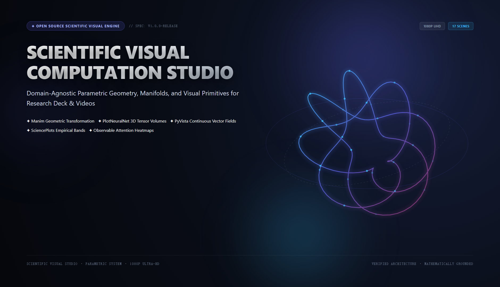
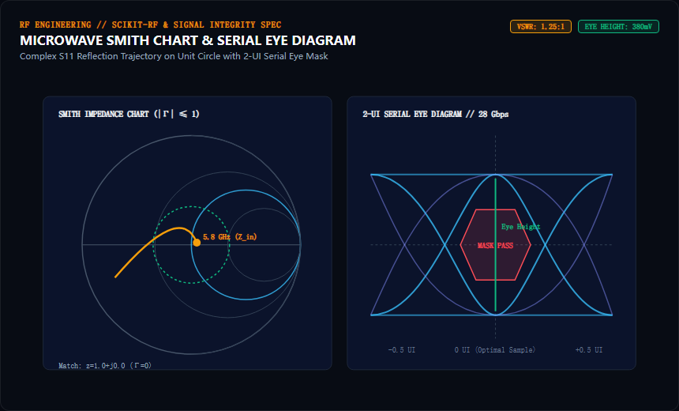
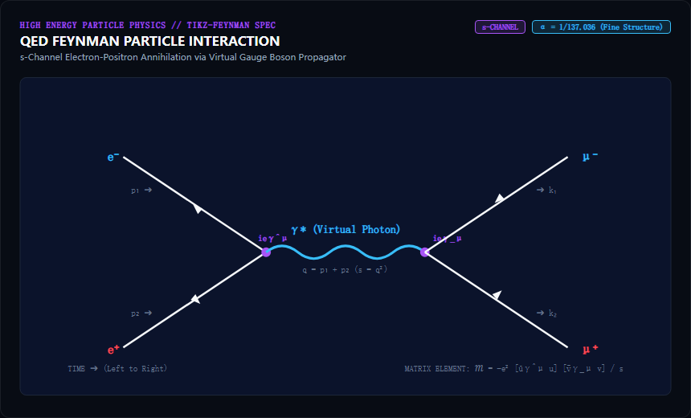

# Scientific Visual Studio 科学可视化工作台 🧪✨

[English](README.md) | **中文说明**

> **面向 AI Agent、学术课件 (Slides) 与程序化视频 (Remotion) 的领域无关科学/数学/算法可视化引擎与智能体技能库。**

[](https://www.python.org/downloads/)
[](LICENSE)
[](skills/visual-storyboard-designer/SKILL.md)
[](.claude-plugin/plugin.json)
[](.cursor/rules/visual-storyboard-designer.mdc)
[](package.json)
[](GALLERY.md)

---

## 🌟 核心概览

**Scientific Visual Studio** 是一套专为各大 AI 编码智能体（Google Antigravity、Claude Code、Cursor、OpenAI Codex、DSH）以及视频/演示文稿渲染引擎打造的**纯抽象、无业务硬编码的科学可视化与排版生成库**。

在传统的教学与论文绘图场景中，图表脚本往往与具体业务场景强耦合，且重度依赖本地笨重的 C++/VTK 编译环境。Scientific Visual Studio 深度吸纳了全球 15+ 权威开源科学计算项目（Manim、SciencePlots、Qiskit、PlotNeuralNet、PyVista、RDKit、scikit-rf 等）的设计精髓，将其抽象为**轻量、高响应、零庞大 C++ 依赖的纯程序化 HTML/SVG 矢量渲染组件**：
- **完全解耦具体场景**：所有接口仅接收张量形状、阻抗矩阵、天体质量比或实验曲线数据，不包含任何业务私有逻辑。
- **开箱即用的赛博学术画风**：天体暗蓝底色（`#080C14`）、微光毛玻璃卡片、高对比度强调色与微等宽遥测标注。
- **全生态智能体即插即用**：支持直接输出矢量 SVG/HTML，无缝嵌入 Remotion 视频帧或 Reveal.js 幻灯片。

---

## 🎨 视觉组件全景图库 (Visual Gallery Grid)

全套 26 个跨学科科学可视化组件与赛博学术排版布局。点击图片可查看高分辨率原图，点击组件名跳转至对应的 API 手册：

| <div align="center"><b>01. Hero Cover 电影级封面</b><br/><a href="assets/gallery/01_hero_cover.html"></a><br/><code>render_premium_hero_cover</code><br/><sub>径向微光、动态网格微粒、版本遥测与技术标签阵列</sub></div> | <div align="center"><b>02. 2D Basis Mapping 二维基底变换</b><br/><a href="assets/gallery/02_matrix_transformation.html"></a><br/><code>render_matrix_transformation_2d</code><br/><sub>3B1B 空间网格形变、基向量映射与行列式面积缩放</sub></div> |
|:---:|:---:|
| <div align="center"><b>03. Formula Derivation 公式推导</b><br/><a href="assets/gallery/03_formula_derivation.html"></a><br/><code>render_latex_formula_derivation_pipeline</code><br/><sub>阶段式推导链路，活跃公式呼吸高亮与推导注释</sub></div> | <div align="center"><b>04. 3D Tensor Topology 张量拓扑</b><br/><a href="assets/gallery/04_plotneuralnet_3d.html"></a><br/><code>render_plotneuralnet_3d_pipeline</code><br/><sub>PlotNeuralNet 等轴测立体张量积木与感受野投影锥</sub></div> |
| <div align="center"><b>05. Attention Heatmap 注意力热力图</b><br/><a href="assets/gallery/05_attention_heatmap.html"></a><br/><code>render_observable_attention_heatmap</code><br/><sub>Query-Key 矩阵色阶、十字聚焦准星与跨词元注意力弧</sub></div> | <div align="center"><b>06. Vector Streamlines 矢量流线场</b><br/><a href="assets/gallery/06_pyvista_streamlines.html"></a><br/><code>render_pyvista_streamlines_vector_field</code><br/><sub>三维流线数值积分、科学色彩标尺与空间包围盒</sub></div> |
| <div align="center"><b>07. Optimization Contours 等高线收敛</b><br/><a href="assets/gallery/07_optimization_contours.html"></a><br/><code>render_optimization_contour_paths</code><br/><sub>非凸势阱等高线，对比 SGD、Momentum、Adam 轨迹</sub></div> | <div align="center"><b>08. Confidence Bands 经验方差带</b><br/><a href="assets/gallery/08_confidence_band.html"></a><br/><code>render_convergence_band_plot</code><br/><sub>SciencePlots 标准训练收敛曲线与 95% 置信方差填充带</sub></div> |
| <div align="center"><b>09. Performance Radar 性能基准雷达</b><br/><a href="assets/gallery/09_radar_chart.html"></a><br/><code>render_multi_metric_radar</code><br/><sub>五维蛛网坐标系与多算法基线重叠评估多边形</sub></div> | <div align="center"><b>10. Dual Code Inspector 源码内存监视</b><br/><a href="assets/gallery/10_dual_code_inspector.html"></a><br/><code>render_dual_code_inspector</code><br/><sub>源码语法高亮执行游标 + 运行时堆变量与梯度表联动</sub></div> |
| <div align="center"><b>11. Cyber Dashboard 赛博多栏仪表盘</b><br/><a href="assets/gallery/11_cyber_dashboard.html"></a><br/><code>render_cyber_academic_dashboard_layout</code><br/><sub>左侧 3D 曲面 + 右侧符号分析 + 底部高频数据总线</sub></div> | <div align="center"><b>12. Triptych Pipeline 三联装架构流水线</b><br/><a href="assets/gallery/12_triptych_pipeline.html"></a><br/><code>render_triptych_pipeline_layout</code><br/><sub>感知-规划-执行闭环拓扑与中继总线吞吐遥测</sub></div> |
| <div align="center"><b>13. 3D Loss Landscape 三维损失流形</b><br/><a href="assets/gallery/13_loss_landscape_3d.html"></a><br/><code>render_loss_landscape_3d</code><br/><sub>非凸参数空间能量曲面、鞍点分岔与下降小球轨迹</sub></div> | <div align="center"><b>14. Reservoir Valve 水箱阻尼节流</b><br/><a href="assets/gallery/14_teachable_reservoir_valve.html"></a><br/><code>render_teachable_reservoir_valve</code><br/><sub>梯度累积与学习率退火物理直觉模型（液位与阀门）</sub></div> |
| <div align="center"><b>15. Top Formula Bottom Dynamic 上下联动</b><br/><a href="assets/gallery/15_top_formula_bottom_dynamic.html"></a><br/><code>render_top_formula_bottom_dynamic_layout</code><br/><sub>顶部拉格朗日数学公理横幅 + 底部广义坐标动态形变</sub></div> | <div align="center"><b>16. Quad Comparison Matrix 四象限消融矩阵</b><br/><a href="assets/gallery/16_quad_comparison_matrix.html"></a><br/><code>render_quad_comparison_layout</code><br/><sub>2x2 多模型基线横向消融评测矩阵与状态关键指标</sub></div> |
| <div align="center"><b>17. Terminal Card 科学遥测终端卡片</b><br/><a href="assets/gallery/17_scientific_terminal_card.html"></a><br/><code>render_scientific_terminal_card</code><br/><sub>实时高频帧率角标、多通道遥测字典与卡片容器包装</sub></div> | <div align="center"><b>18. Quantum Bloch Circuit 量子态与线路</b><br/><a href="assets/gallery/18_quantum_bloch_circuit.html"></a><br/><code>render_quantum_bloch_circuit</code><br/><sub>Qiskit iqp-dark 3D 布洛赫球面态矢量 + 多比特量子门线路</sub></div> |
| <div align="center"><b>19. Bode / Nyquist 频域响应与稳定性</b><br/><a href="assets/gallery/19_bode_nyquist_frequency.html"></a><br/><code>render_bode_nyquist_frequency_plot</code><br/><sub>对数 Bode 增益/相位裕度 + 复平面 Nyquist 临界点 (-1,0) 绕行</sub></div> | <div align="center"><b>20. GNN Message Passing 图神经网络拓扑</b><br/><a href="assets/gallery/20_graph_network_topology.html"></a><br/><code>render_graph_network_topology</code><br/><sub>NetworkX/PyG 异质图节点光晕、聚类分组与有向消息传递弧</sub></div> |
| <div align="center"><b>21. Genomic Sequence Ribbon 序列特征轨道</b><br/><a href="assets/gallery/21_genomic_sequence_ribbon.html"></a><br/><code>render_genomic_sequence_ribbon</code><br/><sub>WebLogo 信息熵字母堆（0-2 bits）+ 线性开放阅读框 CDS 箭头轨道</sub></div> | <div align="center"><b>22. DAG Workflow Statechart 任务编排调度</b><br/><a href="assets/gallery/22_dag_workflow_statechart.html"></a><br/><code>render_dag_workflow_statechart</code><br/><sub>Airflow/Prefect 分层拓扑、生命周期状态与正交依赖总线</sub></div> |
| <div align="center"><b>23. Chemical Synthesis 2D分子反应式</b><br/><a href="assets/gallery/23_molecule_reaction.html"></a><br/><code>render_molecule_reaction_scheme</code><br/><sub>RDKit 规整六边形骨架、立体楔形键、CPK 原子色与催化产率标注</sub></div> | <div align="center"><b>24. Synodic Lagrange Orbits 三体拉格朗日点</b><br/><a href="assets/gallery/24_synodic_lagrange_orbit.html"></a><br/><code>render_synodic_lagrange_orbit</code><br/><sub>Astropy/Poliastro CR3BP 会合坐标系、L1-L5 平衡点与李雅普诺夫晕轨道</sub></div> |
| <div align="center"><b>25. Smith Chart & Eye Diagram 史密斯圆图与眼图</b><br/><a href="assets/gallery/25_smith_eye_pair.html"></a><br/><code>render_smith_eye_pair</code><br/><sub>scikit-rf 等电阻/等电抗圆反射系数 S11 + 2 UI 串行通信眼图掩模</sub></div> | <div align="center"><b>26. Feynman Diagram 费曼微扰相互作用</b><br/><a href="assets/gallery/26_feynman_diagram.html"></a><br/><code>render_feynman_diagram_interaction</code><br/><sub>TikZ-Feynman QED 费米子流向箭头、虚拟规范玻色子正弦波与耦合顶点</sub></div> |

*查看全部组件的详细参数说明与 Python 代码示例，请参阅完整的 [GALLERY.md](GALLERY.md)。*

---

## 📋 组件完整分类索引

| 学科领域 | 组件名称 | 函数名 | 关键算法 / 学术规范来源 |
|:---|:---|:---|:---|
| **赛博排版** | Hero 电影级封面 | `render_premium_hero_cover` | Widescreen Cyber-Academic Header Spec |
| **赛博排版** | 多栏遥测仪表盘 | `render_cyber_academic_dashboard_layout` | Multi-Pane Telemetry Split Dashboard |
| **赛博排版** | 三联装架构流水线 | `render_triptych_pipeline_layout` | Sense-Plan-Act 3-Stage Closed Loop |
| **赛博排版** | 上公式下动态仿真 | `render_top_formula_bottom_dynamic_layout` | Theorem-Proof Synchronous Split |
| **赛博排版** | 四象限消融矩阵 | `render_quad_comparison_layout` | 2x2 Empirical Benchmark Quad Matrix |
| **赛博排版** | 科学终端视窗卡片 | `render_scientific_terminal_card` | Framed Realtime Telemetry Wrapper |
| **数学与几何** | 二维仿射基底变换 | `render_matrix_transformation_2d` | 3Blue1Brown / Manim Basis Mapping |
| **数学与几何** | 解析公式分步推导 | `render_latex_formula_derivation_pipeline` | TransformMatchingTex Step Pipeline |
| **量子物理** | 量子态与线路遥测 | `render_quantum_bloch_circuit` | Qiskit / QuTiP Bloch Sphere & Multi-Qubit Circuit |
| **深度学习** | 3D 等轴测张量拓扑 | `render_plotneuralnet_3d_pipeline` | PlotNeuralNet / ConvNetDraw 3D Tensors |
| **深度学习** | 自注意力交互热力图 | `render_observable_attention_heatmap` | Observable Plot Query-Key Softmax & Attention Arcs |
| **图网络** | GNN 消息传递网络 | `render_graph_network_topology` | PyG / NetworkX Heterogeneous Topology |
| **控制理论** | Bode / Nyquist 频域分析 | `render_bode_nyquist_frequency_plot` | Python-Control Frequency & Nyquist Stability (-1, 0) |
| **科学流体** | 连续三维矢量流线场 | `render_pyvista_streamlines_vector_field` | PyVista / VTK Continuous Vector Streamlines |
| **优化理论** | 3D 非凸损失流形 | `render_loss_landscape_3d` | Hao Li Non-Convex Loss Landscape |
| **优化理论** | 非凸优化等高线收敛 | `render_optimization_contour_paths` | SGD vs Momentum vs Adam Convergence Paths |
| **统计图表** | 经验收敛曲线与方差带 | `render_convergence_band_plot` | SciencePlots IEEE / Nature 95% Confidence Band |
| **基准评测** | 正交多维性能雷达 | `render_multi_metric_radar` | Normalized Multi-Criteria Orthogonal Profile |
| **计算生物** | 基因序列与特征轨道 | `render_genomic_sequence_ribbon` | Biopython / WebLogo (0-2 bits) & DNA Features Viewer |
| **任务调度** | 分布式 DAG 编排流水线 | `render_dag_workflow_statechart` | Apache Airflow / Prefect / XState DAG |
| **化学信息** | 2D 分子反应拓扑 | `render_molecule_reaction_scheme` | RDKit Kekule 30°/90° Skeletal & Reagents |
| **天体物理** | CR3BP 会合拉格朗日轨道 | `render_synodic_lagrange_orbit` | Astropy & Poliastro Synodic L1-L5 & Lyapunov Orbit |
| **微波射频** | 史密斯圆图与眼图 | `render_smith_eye_pair` | scikit-rf Smith Chart (r, x) Circles & 2-UI Eye Mask |
| **粒子物理** | 费曼粒子微扰相互作用 | `render_feynman_diagram_interaction` | TikZ-Feynman QED s-Channel Fermion / Photon Wave |
| **直觉教学** | 水箱阻尼节流模型 | `render_teachable_reservoir_valve` | Teachable Figures Mechanical Metaphor |
| **代码运行** | 双栏源码与堆栈监视 | `render_dual_code_inspector` | Synchronized Source Pointer & Heap Topology |

---

## 📚 引用的开源库与设计说明

| 开源项目 | Stars (约) | 领域角色 | 本项目抽象与引用实现说明 |
| :--- | :--- | :--- | :--- |
| **[RDKit](https://github.com/rdkit/rdkit)** | 3.7k | 化学信息学事实标准 | 采用 RDKit `MolDraw2D` 的 30°/90° 六边形骨架、立体楔形键与 CPK 原子色标，构建化学反应式组件。 |
| **[scikit-rf](https://github.com/scikit-rf/scikit-rf)** | 1.0k | 微波与射频工程 | 采用其史密斯圆图等电阻/等电抗圆方程与驻波比圆，结合 2-UI 串行通信眼图掩模。 |
| **[Astropy](https://github.com/astropy/astropy)** / **[Poliastro](https://github.com/poliastro/poliastro)** | 5.4k / 1.0k | 天体物理与轨道力学 | 采用圆型限制性三体问题（CR3BP）会合坐标系，精确标定 L1-L5 平衡点与李雅普诺夫晕轨道。 |
| **[TikZ-Feynman](https://github.com/JP-Ellis/tikz-feynman)** | 200 | 高能物理费曼图标准 | 规范费米子流向箭头、虚拟光子正弦波与强相互作用胶子螺旋线圈。 |
| **[Qiskit](https://github.com/Qiskit/qiskit)** | 8.0k | 量子计算事实标准 | 采用 Qiskit `iqp-dark` 官方配色语法，构建轻量化 3D 布洛赫球面态矢量投影与多比特量子门电路视窗。 |
| **[Python-Control](https://github.com/python-control/python-control)** | 1.7k | 控制理论与频域分析 | 提取其 Bode 对数频率响应与 Nyquist 临界点 `(-1, 0)` 环绕判定算法，生成矢量稳定性分析图。 |
| **[NetworkX](https://github.com/networkx/networkx)** / **[PyG](https://github.com/pyg-team/pytorch_geometric)** | 17.4k / 20k | 图算法与图神经网络 | 提炼力导向布局与异质节点聚合逻辑，提供带辐射光晕与有向消息传递弧的高清图拓扑。 |
| **[Biopython](https://github.com/biopython/biopython)** / **[WebLogo](https://github.com/gecrooks/weblogo)** | 5.3k / 200 | 生物信息与基因序列分析 | 遵循经典 A/C/G/T 信息熵比特高度配色规范，联动 DNA Features Viewer 线性特征轨道。 |
| **[Apache Airflow](https://github.com/apache/airflow)** / **[Prefect](https://github.com/PrefectHQ/prefect)** | 40.5k / 19.5k | 任务编排与 DAG 调度 | 规范正交依赖总线走线与 `[queued, running, success, failed]` 状态生命周期颜色。 |
| **[Manim](https://github.com/3b1b/manim)** / **[Manim Community](https://github.com/ManimCommunity/manim)** | 97k / 43k | 数学动画事实标准 | 仿射基底变换矩阵几何演算与微积分公式变形管线。 |
| **[SciencePlots](https://github.com/garrettj403/SciencePlots)** | 9.4k | 期刊级科学图表风格 | Nature / IEEE 投稿级配色、字体比例与 95% 置信方差带平滑算法。 |
| **[PlotNeuralNet](https://github.com/HarisIqbal88/PlotNeuralNet)** | 19k | 顶会论文 3D 张量立体图 | 纯程序化 CSS 3D 透视变换与 SVG 跨层感受野投影锥自动生成。 |
| **[PyVista](https://github.com/pyvista/pyvista)** | 3.9k | 科学网格与体数据 | 三维连续流线积分、空间包围盒与科学 Colormap 标尺。 |

---

## 🛒 为什么在 dsh-market 搜索不到？以及如何使用

### 问：为什么在 `https://github.com/dsh-market/dsh-market` 插件市场中搜索不到？
**答**：
1. **DSH 插件市场的运作机制**：`dsh-market` 客户端并不会实时扫描整个 GitHub，而是每日定时从两个上游索引拉取静态 JSON 清单：
   - npm 镜像包 `dsh-plugin-catalog`
   - 官方精选清单 `awesome-dsh-plugin.com/plugins.json` (对应 GitHub 仓库 `bobby-sheng/dshget-data`)
2. **新发布的独立仓库**：新创建的 GitHub 项目未发布到 npm 且未向该清单提交 PR 时，默认不会出现在市场的中心搜索框中。
3. **已完成的兼容适配**：
   - 本项目已正式配置符合 DSH 规范的 [package.json](package.json)，声明了 `engines.dsh >= 0.1.0` 与 `dsh-plugin` 属性。
   - **在 DSH 中直接安装**：打开 DSH 终端或命令行，直接执行：
     ```bash
     dsh plugin add github:TardisBooo/scientific-visual-studio
     ```
   - **提交官方市场检索收录**：只需向 `bobby-sheng/dshget-data` 或 `dsh-market/dsh-market` 提交 Pull Request 将本仓库加入 `plugins.json` 即可出现在全球中心检索列表中。

---

## 🤖 跨平台 AI 智能体生态集成

| 平台 | 配置文件 | 使用方式 |
| :--- | :--- | :--- |
| **Google Antigravity & Grok** | [plugin.json](plugin.json) | 通过插件管理器直接载入或克隆到插件目录 |
| **Claude Code** | [CLAUDE.md](CLAUDE.md) / [.claude-plugin/plugin.json](.claude-plugin/plugin.json) | Claude Code 自动读取 `CLAUDE.md`，自然语言提问时自动匹配组件 |
| **Cursor & Codex** | [.cursor/rules/visual-storyboard-designer.mdc](.cursor/rules/visual-storyboard-designer.mdc) / [.codex/skill.json](.codex/skill.json) | Cursor Composer 中提示词直接唤醒 |
| **DeepSeek Harness (DSH)** | [package.json](package.json) / [skills/visual-storyboard-designer/SKILL.md](skills/visual-storyboard-designer/SKILL.md) | `dsh plugin add github:TardisBooo/scientific-visual-studio` |
| **Python 项目** | [pyproject.toml](pyproject.toml) | `pip install -e .` 本地即装即用 |

---

## 📄 开源协议

本项目采用 [Apache 2.0 许可证](LICENSE) 开源。商业友好、学术友好，欢迎自由使用与二次扩展。
